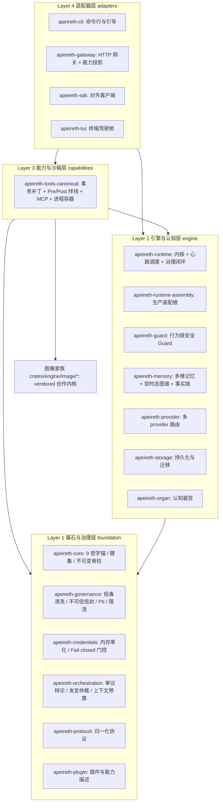

# Apeireth 2.0 团队接手现行手册（Team Handover Manual）

> **文档版本**：3.0（合成批：合并 4 篇同题材接手文档，2026-10-23）
> **更新日期**：2026-10-23
> **适用对象**：核心研发团队、架构师、安全审计员，以及任何新接手本仓的成员或新开工的 AI 线
> **一句话定位**：本仓接手工作的**单一入口**——只写现值口径；任何数字一律指向真源文件，本手册不抄第二份
> **注意**：本文档版本号与 `Cargo.toml` 的 `workspace.version`（LOCKED，仅 release authority 可改）是两条独立的轴，不要混用

---

## 0. 先说三句实话

1. **这是什么**：一个用 Rust 写的**个人工具型助手底座**——开源免费、双协议（Apache-2.0 OR MIT）、主战场是个人用户的工具型助手（[ADR-0013](../adr/0013-open-source-personal-utility-assistant.md)，owner 2026-10-23 拍板）。它不是现成应用：模型是租户，底座不绑定任何一家模型，换模型不重做底座。
2. **这不是什么**：不是「已经都接好」的系统。当前大量能力是**库级实现但生产未接线**（唯一清单见[未接线台账](../status/unwired-ledger.md)）；**默认关**的能力不是系统现状（见[能力矩阵 §0.2](capabilities-matrix.md)）；带 `#[ignore]` 的 live E2E 是**未实测**，不是「通过了」。
3. **现在真实状态**：workspace = **30 members（29 crates + bench harness）**（[contract.toml](../architecture/contract.toml) `[workspace]`）；能力声明逐条落在 [claims.yaml](../status/claims.yaml)；批次债在 [00-backlog.md](../04-internal/backend-enhancement/00-backlog.md)，系统级缺口在 [SG 台账](../04-internal/backend-enhancement/system-gap-ledger-2026-10-18.md)，真机实测记录在 [live-verification-ledger.md](../04-internal/live-verification-ledger.md)。**测试数字只认 [test-baseline.md](test-baseline.md) 一处**，其余文档只引用不抄写。

---

## 1. 接手第一天该做什么

原则：**第一天不写代码**。先跑通门禁、读两份宪章，再认领活。

### 1.1 先读这 4 份（按顺序）

| # | 文件 | 为什么先读 |
|---|---|---|
| 1 | [AGENTS.md](../../AGENTS.md) | 仓库级硬短指令：0 装 PASS / 中性表述 / 口径纪律 / 提交格式 / 校验命令 |
| 2 | [ENGINEER-MANIFESTO.md](../04-internal/ENGINEER-MANIFESTO.md) | 工程总纲：9 哲学锚、LOCKED 5 项、O-6 三阶审查、commit 与派子代理模板 |
| 3 | [CONSTRUCTION-DISCIPLINE.md](../04-internal/backend-enhancement/CONSTRUCTION-DISCIPLINE.md) | 多线并发施工宪章：零债 / 叠加不覆盖 / 口径诚实 / 门禁 |
| 4 | [contract.toml](../architecture/contract.toml) | 可执行架构契约：允许层边、棘轮预算、扩展点登记、例外规则 |

### 1.2 跑这组命令（可直接复制）

```powershell
# 0) 同步 + 看清工作树（并行线多，先侦察再动手）
git fetch origin; git status; git log --oneline -5

# 1) 构建
cargo build --workspace --locked

# 2) 全量测试 —— 唯一执行器（不自拼 cargo test；锁与失败分类由它负责）
pwsh scripts/gate_full.ps1 -FailIfBusy
#    期望：0 failed。套件 / passed / ignored 三个数字只认 test-baseline.md §1（本文不抄）

# 3) clippy 0 警告 + fmt 0 diff
cargo clippy --workspace --all-targets --locked -- -D warnings
cargo fmt --all -- --check

# 4) 架构守卫 + 文档真源
python scripts/arch_guard.py --strict          # 期望 VIOLATIONS 0
python scripts/docs_truth.py --verify --check  # 期望 fail=0 stale=0

# 5) 改代码后的快反馈（改动 crate + 反向依赖）
python scripts/verify_changed.py

# 6) 提交（显式 author + staged secret/中性扫描）
pwsh scripts/commit.ps1 -MessageFile <msg.txt>
```

### 1.3 结果怎么读

- 任一门禁红 = 先定位，**不要**先改真源文件（test-baseline / claims / contract 都是别人的真源）。
- 全量门禁偶发被环境打断（临时目录拒写、页文件不足、容器或计划任务权限）——查 [00-backlog.md](../04-internal/backend-enhancement/00-backlog.md) 债栏已登记的环境债条目，按「本批 scoped 绿 + 环境性失败」如实记，不代改真源数字。
- 前端是独立 workspace（`frontend/companion-desktop`），`pnpm test` 的数字**不并入**测试基线表。

---

## 2. 项目全貌：四层单向依赖 + 30 members

### 2.1 组成

- **30 members = 29 crates + bench harness**。
- 其中 **18 个产品 crate**：foundation 6 / engine 7 / capabilities 1 / adapters 4（分层明细以 [contract.toml](../architecture/contract.toml) `[layers]` 为准）。
- **11 个图像家族 crate**（`crates/engine/image/*`：许可搬运线第一批 vendored 创作内核 + 我们自己的接口层，溯源与质检见 [license-port](../04-internal/license-port/README.md)）。
- **1 个 bench harness**（基准复现包，不计入产品 crate）。
- 逐包职责另见 [crates.md](crates.md)——该索引尚未列图像家族与终端驾驶舱，**成员数以 contract.toml 与根 `Cargo.toml` 为准**。

### 2.2 四层依赖拓扑



允许的层边与「禁止循环」以 contract.toml `[deps].allowed_layer_edges` 为准；**新增层边 = 结构变更，必须先出 ADR 并改契约**。

### 2.3 已归档（不要去找）

- 多模态感知 crate 与 SDK 四孤岛已归档至 `legacy/archived/`（2026-10-20，[ADR-0005](../adr/0005-r4-crate-topology-surgery.md) R4b）。当前 active workspace **不存在**这两个 crate，原文档里提到它们的段落一律按已归档处理。
- 历史口径（2026-10-18）：31 members（30 crates + bench harness）；历史口径（2026-10-18 之前）：20 members（19 crates + bench harness）。这两条只作追溯，**不得当现值引用**。

---

## 3. LOCKED 5 项与 9 哲学锚

### 3.1 LOCKED 5 项（改前必查，0 触碰）

| LOCKED 项 | 位置 | 保护说明 |
|---|---|---|
| 9 哲学锚本体 | `crates/foundation/core/src/eight_anchors.rs` | 编译期锁；增删改须主人明确授权 |
| 键集（现行 14 键） | `crates/foundation/core/src/philosophy.rs` | 判别词汇表；已永久降级为哲学标准，不接回运行时强制 |
| 3 项不可变脊柱 | `crates/foundation/core/src/onion.rs` | 自停用判定 / L0 高可用隔离 / 键集 verdict cache |
| `workspace.version` | 根 `Cargo.toml` | 仅 release authority 可改 |
| R11 baseline 3 值 | 历史归档（只引用，不改） | 数值不在本文复制，见 contract.toml `[locked]` 与 ENGINEER-MANIFESTO §10 |

> 例外必须带 owner / 主代理的拍板记录（写在 commit message 或计划文档里）。**0 例外 = 0 改 LOCKED**。
> 键集历史口径：13 键为 2026-10-11 之前口径，现行 14 键由 [ADR-0006](../adr/0006-formalize-14-keys.md) 正式化。

### 3.2 9 哲学锚（只列定义，细则看本体）

| 锚 | 一句话 | 落到工程上是什么 |
|---|---|---|
| S-1 北极星 | 一切服务北极星目标 | 目标不清就不开工 |
| S-2 实事求是 | 写前先验证，事实高于叙事 | 数字要可复核；文档随代码同步 |
| S-3 质量工程化 | 工程严谨压倒叙事 | 门禁 + clippy 0 警告 + 完备单测 |
| O-1 安全优先 | 安全压倒其他关切 | Fail-closed 默认拒绝、进程隔离、内存零化 |
| O-2 前人肩上 | 借、标注、改（不抄） | 引用有出处；搬运走许可搬运线四关质检 |
| O-3 干到底 | 不做半截活 | 1 commit = 1 任务，做完含测试与文档 |
| O-4 任何人都能接手 | 文档单独能 onboarding | 本手册就是这条锚的兑现 |
| O-5 不假装（0 装 PASS） | 绝不伪装 | 未接线写未接线；桩显式断言；未实测写未实测 |
| O-6 永远追求最优 | 总体 > 系统 > 架构三阶审查 | 每条工程决策必写三段审查 + 拒掉的备选 + 拒理由 |

细则见 [philosophy.md](../01-architecture/philosophy.md)；能力四级口径（IMPLEMENTED / PRODUCTION WIRED / DEFAULT ENABLED / HARDWARE VALIDATED）见 [system-capabilities.md](../01-architecture/system-capabilities.md) 头部。

### 3.3 O-6 三阶审查怎么写

**总体最优**（更大语境里这是不是最优切入点）→ **系统最优**（改动该放哪一层）→ **架构最优**（公开 API 形状与 crate 边界是不是最优）。每段都要写出**拒掉的备选**与**拒的理由**；用「改了什么」代替「为什么」= O-6 失守。借口清单（工作量大 / 等以后做 / 阶段先这样 / 上一代如此 / 用户没要求 / 派子代理就行）一律不算理由。

---

## 4. 能力与开关现值

### 4.1 唯一真源

- 能力矩阵与默认开关表：[capabilities-matrix.md](capabilities-matrix.md) §0.2（以生产装配实况 `crates/engine/runtime-assembly/src/canonical/production.rs` 为准）。
- 逐条能力声明：[claims.yaml](../status/claims.yaml)（每条含 level / default / switch_env / sources / tests / verified_at；条数与分布以该文件为准，本文不抄）。
- 运行时投影：生产面板读 `/v1/apeireth/capabilities` 的 `supported` / `available` / `reason`，**不是**读能力矩阵表。

### 4.2 「默认关」是什么意思（最容易搞错的一条）

- 危险面与重成本面默认关，需 env 显式开启（例：`APEIRETH_ENABLE_SHELL` / `APEIRETH_ENABLE_FETCH` / `APEIRETH_ENABLE_ORGANS` / `APEIRETH_COGNITIVE_JUDGE` / `APEIRETH_COGNITIVE_COUNCIL`，以及写族总闸 `APEIRETH_ENABLE_FILE_WRITE`）。
- 多数旋钮只认精确值 `"1"`；未设 / `"0"` / 其它取值一律判关（fail-closed）。关时应当**逐字节零变化**（有 golden / zero-change 测试钉死）。
- **默认关 ≠ 没有实现**，也 **≠ 已接线**。「已接线且默认关」是常态（claims 里 PRODUCTION WIRED 与 default: OFF 同时成立）。
- 只读工具面（filesystem / search / repo）与记忆召回、写回等默认开；本地只读可用 `APEIRETH_DISABLE_LOCAL_READ_TOOLS=1` 关。
- 开关全集与默认值的权威登记：[env-registry.toml](../architecture/env-registry.toml)；开关权力审计见 [capability-switch-power-audit.md](../02-guides/capability-switch-power-audit.md)。

### 4.3 宣称的四个层级（写文档前必须选对）

IMPLEMENTED（库内可跑、测试过）≠ PRODUCTION WIRED（生产装配有构造/调用点且实测跑过）≠ HARDWARE VALIDATED（真机验证过）；**DEFAULT ENABLED 不是一级，是横切属性**。双向性：不许把「已实现未接线」说成 0 装，也不许把 0 装说成已接线。

---

## 5. 红线与未接线

### 5.1 动态红线（现行，2026-10-23 拍板）

红线不再是「数据一律不出本机」，而是**「用户不想外露的数据不能外流」**，按**对象 × 用途 × 可撤销**逐条控制（[ADR-0013](../adr/0013-open-source-personal-utility-assistant.md)）。唯一实现面 = 出境脱敏闸 + 出网控制 + 对象级判定 + 出域账本；**当前代码在仓、未接电**，它是本项目的承重墙。接线设计见 [egress-gate-wiring-design-2026-10-23.md](../04-internal/backend-enhancement/egress-gate-wiring-design-2026-10-23.md)。

### 5.2 结构红线（棘轮，只减不增）

从 [contract.toml](../architecture/contract.toml) 的 `[budgets]` / `[deps]` / `[exceptions]`：workspace crate 数上限、生产依赖边上限、单文件行数上限、`APEIRETH_*` 开关名数量上限、允许层边白名单、禁止生产与开发依赖环；**结构类与方向类例外预算为 0**，新增必须走 ADR。

### 5.3 未接线：最关键 3 条（台账全文见 [unwired-ledger.md](../status/unwired-ledger.md)）

| # | 条目 | 现状（实证） | 处置 / owner |
|---|---|---|---|
| W1 | IM 桥生产构造 + 设备审批面注入 | 全仓仅测试调用，生产装配无构造点 ⇒ 高风险动作档「必须 IM 审批卡」在生产发不出卡 | owner 2026-10-23 裁定**暂不接**，按产品面专项做（[设计输入](../04-internal/backend-enhancement/im-channel-module-2026-10-23.md)）；在此之前该档维持「缺卡即拒」（有意为之，不是故障） |
| W2 | `verify_multisig` / `multi_sign` | 全库多签调用点为零；高风险动作的人审只有占位 | 触发：v2.1 真多签（安全线） |
| W7 | 教训对象 `Lesson` | L1 + L2 已接线（生产）；L3 反思步、L4 上下文注入仍缺 | 记忆线；L4 注入纪律需 owner 拍板预算 |

> 另有一条承重墙（出境脱敏闸等未接电，见 §5.1），以及系统级缺口（可取消 worker、上下文分页、插件隔离、技能包、记忆对象级共享等）——清单在 [SG 台账](../04-internal/backend-enhancement/system-gap-ledger-2026-10-18.md)，拍板权在 owner。

---

## 6. 工程纪律

### 6.1 硬约束

1. **纯 Safe Rust**：全工作区 `#![deny(unsafe_code)]`，凭据库 `#![forbid(unsafe_code)]`；不引未经审计的 C-FFI 与 unsafe 裸指针。
2. **0 装 PASS**：未接线就写「未接线」；桩写 `unimplemented!()` / `Err(NotImplemented)` 并显式断言；默认关的能力不写成系统现状；live E2E 没跑过写「未实测」。
3. **clippy 0 警告 / fmt 0 diff**：提交前必跑（命令见 §1.2）。
4. **单向依赖**：上层可依赖下层，禁止反向引用与同层成环；新增层边走 ADR。
5. **1 commit = 1 任务**：conventional commits，scope = crate 名或文档路径。
6. **中性表述**：代码 / 注释 / commit 零第三方产品名、零「移植 / 借鉴」措辞（真实路径与研究引注走豁免表，见 [CONSTRUCTION-DISCIPLINE.md](../04-internal/backend-enhancement/CONSTRUCTION-DISCIPLINE.md) §三.4 与 §〇之二）；取材通道按 [github-fetch-guide.md](../04-internal/github-fetch-guide.md) §〇 选路，先测活再取材。

### 6.2 commit message 模板（O-6 三阶审查必带）

```
<type>(<scope>): <一句话>

- 0 装诚实真账:
  - 测试: <本批实测数字>（口径见 docs/03-reference/test-baseline.md）
  - clippy: cargo clippy --workspace --all-targets --locked -- -D warnings = 0 警告
  - 0 触碰 LOCKED 5 项
  - 0 引新外部 dep（Cargo.lock 0 行 diff，或写清新增理由）
- O-6 三阶审查:
  - 总体最优: <在更大语境里是不是最优切入点？与备选比较 + 选了哪个 + 拒理由>
  - 系统最优: <改动放在哪一层最合适？与备选比较 + 拒理由>
  - 架构最优: <公开 API 形状 / crate 边界 / 依赖面是不是最优？拒的备选 + 拒理由>
- 影响面: <文件清单 + 行数>
- 后续 stage: <下一步，或"无">
```

type ∈ feat / fix / refactor / docs / test / chore / perf / ci / build / revert。

### 6.3 派子代理 brief 模板（派是手段，不是目的）

```
任务: <明确产出，不是模糊方向>
必读: <文档 file:line>
必跑: <命令 + 期望输出>
必写: <报告结构，含 0 装诚实真账 + 0 触碰 LOCKED 声明>
不 commit: <等主代理审>
```

派后**主代理必亲验**：子代理报「通过」要自己跑一遍，报「0 触碰 LOCKED」要自己 diff 一遍。子代理报告 = 工作产出，不等于已验证。

---

## 7. 接手人 5 条 actionable advice

1. **先跑基线，再写代码。** `gate_full.ps1 -FailIfBusy` + clippy + `arch_guard --strict` + `docs_truth --verify` 四条绿了再动手；红了先查环境债，别动真源。
2. **别混同名的两族东西。** `crates/capabilities/tools/src/supervisor.rs` 的 `SubSupervisor` 是 v2 的进程级 supervisor，不是历史版本的调度工具族；`apeireth-guard` 是行为链安全 Guard，而 PII 脱敏在 `apeireth-governance::input_security`——同名不同物。
3. **锚只有 9 个，编号稳定。** commit message 里出现的「锚 #11 / #18」是重构批次的**子项序号**，不是锚编号（对照 [o6-session-log-2026-08-27.md](../04-internal/o6-session-log-2026-08-27.md) §1）。
4. **四级口径双向都要守。** 写「已实现」要说清落在哪一级；写「0 装」也要说清是**没实现**还是**实现了没接线**。查证入口三个：[claims.yaml](../status/claims.yaml)、[unwired-ledger.md](../status/unwired-ledger.md)、[live-verification-ledger.md](../04-internal/live-verification-ledger.md)。历史目录（`legacy/`、`docs/archive/`）只引用不改。
5. **认知模块只有一个装配根。** 生产装配根是 `apeireth-runtime-assembly::canonical::production`（`ProductionModules::build` + `ProductionModulesConfig`）；模块注册走 `register_hook` ABI，不直接改内部状态，也不要在 CLI / Gateway / SDK 侧另注册第二套模块（历史 ledger 见 [cognitive-module-wiring.md](../04-internal/cognitive-module-wiring.md)）。

---

## 8. FAQ

**Q1：跑测试时提示依赖下载不下来怎么办？**
先 `cargo fetch`，或加 `--offline` 用本地缓存；但**全量测试不要自拼 `cargo test`**——唯一执行器是 `pwsh scripts/gate_full.ps1 -FailIfBusy`。单 crate 定位用 `cargo test -p <crate> --locked`。

**Q2：为什么不可信输入被包成 `<<< [`？**
故意设计（`crates/foundation/governance/src/untrusted_mark.rs`）：外部文本里出现 `<<<[` 会让解析器提前闭合信封，强制插入空格是消解逃逸攻击的标准防御。

**Q3：为什么找不到 Prompt Cache 稳定器？**
**它已经不在生产仓里。** 该能力随 R7-4a（[ADR-0007](../adr/0007-r7-context-session-unification.md)）归档到 `legacy/archived/prompt-stabilizer/`，claims 中对应条目已改判 NOT IMPLEMENTED（生产中不存在该能力）。现行上下文 / 前缀稳定的单管线在 `apeireth-orchestration` 的 `context_budget`。按旧文档去找会走空。

**Q4：怎么校验事实时间线没被篡改？**
`ArbitrationTimeline::verify_integrity()`（`crates/engine/memory/src/arbitration.rs`）：哈希链与 Merkle 根吻合则返回完整校验报告；被改会定位到断裂序号。

**Q5：面板上「不支持」的能力是不是就是没做？**
不一定。`supported`（是否存在）与 `available`（当前装配 / 凭据下是否可用）是两列，未接线项在能力清单里以 `reason` 明示。判断一个能力到底到哪一级，只认 [claims.yaml](../status/claims.yaml)。

---

## 9. 相关文档（按接手顺序读）

**必读**

1. [AGENTS.md](../../AGENTS.md) — 仓库级硬短指令：0 装 PASS、中性表述、口径纪律、提交格式、校验命令。
2. [ENGINEER-MANIFESTO.md](../04-internal/ENGINEER-MANIFESTO.md) — 工程总纲：9 锚、LOCKED 5 项、O-6 三阶审查、commit 与派子代理模板。
3. [CONSTRUCTION-DISCIPLINE.md](../04-internal/backend-enhancement/CONSTRUCTION-DISCIPLINE.md) — 多线并发施工宪章：零债、叠加不覆盖、门禁与验证。
4. [contract.toml](../architecture/contract.toml) — 可执行架构契约：允许层边、棘轮预算、扩展点登记、例外规则。
5. [test-baseline.md](test-baseline.md) — **测试数字唯一真源**（其余文档只引用不抄）。
6. [claims.yaml](../status/claims.yaml) — 能力声明唯一真源（level / default / 证据 / 复核时点）。
7. [unwired-ledger.md](../status/unwired-ledger.md) — 「已实现但没接电」的唯一清单。
8. [capabilities-matrix.md](capabilities-matrix.md) — 能力矩阵与默认开关现值（§0.2）。

**按需**

9. [philosophy.md](../01-architecture/philosophy.md) — 9 哲学锚本体与 O-6 不做借口清单。
10. [system-capabilities.md](../01-architecture/system-capabilities.md) — 四级能力口径与各能力域契约。
11. [00-backlog.md](../04-internal/backend-enhancement/00-backlog.md) — 批次级想法清单与债栏（唯一债栏）。
12. [system-gap-ledger-2026-10-18.md](../04-internal/backend-enhancement/system-gap-ledger-2026-10-18.md) — 系统级能力缺口台账（SG 条目，拍板权在 owner）。
13. [live-verification-ledger.md](../04-internal/live-verification-ledger.md) — 「什么真机验过」的唯一记录；写文档前先查，别重测已绿的。
14. [implemented-to-wired-plan-2026-10-21.md](../04-internal/backend-enhancement/implemented-to-wired-plan-2026-10-21.md) — 「已实现 → 已接线」的推进计划与判据。
15. [ADR-0013](../adr/0013-open-source-personal-utility-assistant.md) — 定位与动态红线裁定（现行）。
16. [architecture/handbook.md](../architecture/handbook.md) — 架构线续作手册 + 一分钟健康检查。
17. [fast-feedback-gate.md](../02-guides/fast-feedback-gate.md) — 快反馈门禁怎么用。
18. [cli-onboarding.md](../02-guides/cli-onboarding.md) / [user-manual.md](../02-guides/user-manual.md) — 命令行上手与用户手册。
19. [ROADMAP.md](../../ROADMAP.md) / [CHANGELOG.md](../../CHANGELOG.md) — 顶层路线与变更流水。

**历史卷宗（只读、不改、不当现值）**

- [TO-NEW-TEAM.md](../04-internal/TO-NEW-TEAM.md) / [HANDOFF-NOTES.md](../04-internal/HANDOFF-NOTES.md) — 2026-08 交接快照；本文已吸收其中可复用的部分（开篇三句实话、第一天基线验证、工作流与模板、接手建议），其过期数字与状态表不再引用。
- [next-team-handbook.md](../04-internal/next-team-handbook.md) — **已归档**，其中 2026-08-18 的任务包已被现行 [00-backlog.md](../04-internal/backend-enhancement/00-backlog.md) 取代，任务包以 00-backlog.md 为准。
