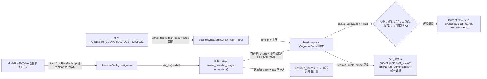

# A. 配额真接口

> `Status: 📋 想法细节（隶属 00-backlog #A）`

## 现状
- 四维配额（token/步数/花费/深度）只存在于 `foundation/orchestration` 的配额类型（`CognitiveQuota`），仅单测构造，**无 env/config 接线、生产无调用点**；
- 设置页「预算与配额」如实标注"暂无接口"（零假旋钮纪律）；
- 回合预算（轮数/单轮工具/上下文字符）已可配且即效——**同族先例**。

## 想法
把四维配额做成**真执行的烧钱闸**：
1. 配额配置面（env + 设置页旋钮，沿回合预算同一条即效缝）；
2. 调度器消费配额：会话累计 token/步数/花费，超限 → 预算耗尽行为（熔断/询问二选一，接生产 `BudgetExhausted`）；
3. self_status 预算节扩四维（真值/上限/余量）；驾驶舱 CACHE/BUDGET 面板与消耗卡同源点亮。

## 缺口
- 花费计量：单价表（每模型）→ token×单价；无单价表则"花费"维暂无接口（诚实纪律）；
- 深度维：调用深度跟踪未实施（旧字段已删），需重新设计（工具调用树深度）。

## 分期
P1 token/步数两维（计量已有）→ P2 花费（单价表）→ P3 深度（调用树）。

## 验收
四维各有：配置旋钮+真实计量+超限行为+自报真值+测试钉死；未实现维度继续如实标注。

## P1 实施记录（token/步数两维·后端执行面）

> 本节为叠加记录（原有各节不动）。前端旋钮另批。

**新符号**（四级口径: 下列 `已接线`=PRODUCTION WIRED、`显式未接线`=NOT WIRED 如实标注）
- `apeireth-orchestration`：`CognitiveQuota` 增量生产接口 `Default`/`unlimited`/`consume_tokens`/`consume_tool_step`（saturating 记账，生产账本即此类型，随会话持久化）；
- `apeireth-runtime::canonical::quota`：`QuotaDimension`（`tokens`/`tool_steps`）、`SessionQuotaLimits`（`None`=不设限，opt-in）、`QuotaExceeded`（维度名/上限/已耗）、`QuotaExhaustedAction`（`CircuitBreak`=已接线；`AskForBudgetExtension`=询问档接口桩，显式未接线）、`CostRateMicros`+`CostRateTable`（花费单价表骨架，显式未接线）、`parse_quota_max_tokens`/`parse_quota_max_tool_steps`（正整数直通、越界钳制 `MAX_QUOTA_TOKENS`/`MAX_QUOTA_TOOL_STEPS`、0/非法回 `None`=不设限）；
- `RuntimeError::BudgetExhausted { dimension, limit, consumed }`（预算耗尽错误帧）；
- `apeireth-tools-canonical`：`QuotaStatus`/`QuotaDimensionStatus`/`QuotaMeterReading`/`SessionQuotaProbe` + `QUOTA_COST_NOT_WIRED`/`QUOTA_DEPTH_NOT_WIRED`/`QUOTA_METER_SCOPE_REQUIRED`；
- `apeireth-runtime-assembly::session_quota_probe`（会话账本只读探测口）；
- `ToolCapability::invoke_in_session` / `SelfStatusSource::snapshot_in_session`（会话作用域透传，默认实现零行为变化）。

**配置→执行→自述三面接线**
1. 配置面：env `APEIRETH_QUOTA_MAX_TOKENS`/`APEIRETH_QUOTA_MAX_TOOL_STEPS` → CLI `quota_max_*_from_env`（与回合预算同一取值纪律，但默认=None 不设限）→ `RuntimeConfig.quota: SessionQuotaLimits`（`with_session_quota`）；
2. 执行面：会话账本 `Session.quota: CognitiveQuota`（token=回合计量 usage 累加、步数=派发工具调用计数；计量点即落库点）；检查点=回合起手/工具调用点/回合收束（并行窗口准入同口径），`consumed >= limit` 即 `BudgetExhausted` 帧收束（熔断档；未答调用补合成结果，前文保留）；
3. 自述面：`budget.quota` 四行——token/步数两维真值（上限/已耗/余量，不设限显示 "—"），花费/深度两维如实"暂无接口"；已耗按会话作用域现探测（无作用域显式 null+原因）。

**测试证据**：`crates/engine/runtime/tests/session_quota.rs`（累计/超限即帧/维度名/回合中止语义/烧钱闸不起烧）、`canonical/quota.rs` 单测（env 解析四态/不设限默认/口径唯一/询问档与单价表骨架显式未接线）、`self_status.rs` 与 `self_status_source.rs` 单测（两维真值与"—"/暂无接口标注/作用域缺失显式 null）、`production_knobs.rs`（env→RuntimeConfig 同源）。

## H-P1 接头记录（单价表来源就绪）

> 叠加记录（原有各节不动）。H 线 P1（模型画像表）交出**单价表来源**：
> `impl CostRateTable for ModelProfileTable`（`apeireth-runtime::canonical::quota`，画像行有输入+输出双价才给价，缺一半/无价/未知回 `None`——绝不编价）
> + `CostRateMicros::cost_micros`（每侧向上取整、饱和——计量点接线时的冻结换算口径）。
> 本文件 P1 记录「`CostRateMicros`+`CostRateTable`（花费单价表骨架）」一句自该批起读作"单价表来源已实现（四级口径: IMPLEMENTED——画像表实现层, 未进计量）"。
> **花费维计量与超限行为仍属 P2**（显式未接线钉死：上限恒不可达、花费列无计量点、自述沿用"暂无接口"）；P2 接线路径 = 计量点按 `usage × rate` 记 `consumed_cost_micros`，`check` 增 `cost_micros` 维走超限即帧同款。详见 [H-model-plane.md](H-model-plane.md) P1 实施记录。

## P2 实施记录（花费维计量与超限·后端批）

> 本节为叠加记录（原有各节不动）。自本批起，P1 记录中「`CostRateMicros`+`CostRateTable`（花费单价表骨架，显式未接线）」「花费/深度两维如实暂无接口」与 H-P1 接头记录末段「花费维计量与超限行为仍属 P2（显式未接线钉死……）」等句**读作历史注记**：花费维已接线（四级口径: PRODUCTION WIRED——计量点装表、上限可绑、超限即帧、自述真值）；深度维继续如实"暂无接口"。

**新符号**
- `apeireth-orchestration::CognitiveQuota`（最小账本增量，跨 crate 报备：消耗计量的唯一归属是账本）：`consume_cost_micros`（有价轮 saturating 记账）、`record_unpriced_round`（无价轮计数）、`unpriced_rounds` 列（`#[serde(default)]` = 旧会话行缺列读回 0 的落库迁移口径）；
- `apeireth-runtime::canonical::quota`：`QuotaDimension::CostMicros`（维度名 `cost_micros`）、`MAX_QUOTA_COST_MICROS`（家族钳制锚点，与 tokens/tool_steps 同口径）、`parse_quota_max_cost_micros`（同族解析纪律四态：正整数直通／越界钳制／0 非法=`None`／未设=不设限）；`SessionQuotaLimits.max_cost_micros`（`None`=不设限；规格速记作 `cost_micros`，实现取家族口径 `max_*`，与 `CognitiveQuota.max_cost_micros`／env `APEIRETH_QUOTA_MAX_COST_MICROS` 同名轴）；`check` 增第三维（tokens → tool_steps → cost_micros 固定序，帧名可复现）；`CostRateTable` 增 `Debug` 超 trait（配置面可检视）；
- `RuntimeConfig.cost_rates: Option<Arc<dyn CostRateTable>>` + `RuntimeBuilder::with_cost_rates`（计量点的价格来源槽；`None` = 全部轮无价）；
- `apeireth-tools-canonical`：`QuotaMeterReading` 增 `consumed_cost_micros`／`unpriced_rounds`；`QuotaDimensionStatus::with_cost_reading`（真值 + 无价轮>0 标"部分计量"）；`QUOTA_COST_PARTIAL` + `quota_cost_partial_note`（文案："部分计量: N 个计量轮无单价未计入 (绝不编价)"）；**`QUOTA_COST_NOT_WIRED` 文案退役**（原位改注历史注记）；
- `apeireth-runtime-assembly`：`budget_status_from_configured` 增第 5 参 `quota_max_cost_micros`；`session_quota_probe` 读数增花费两列（与执行面同一本账）。

**计量点接线图（花费维）**

计量点即落库点：记账先于任何后续副作用落库，自述探测读数精确到最近一笔。

**配置→执行→自述三面接线**
1. **配置面**：env `APEIRETH_QUOTA_MAX_COST_MICROS` → CLI `quota_max_cost_micros_from_env`（同族取值纪律）→ `RuntimeConfig.quota.max_cost_micros`（`with_session_quota`）；单价来源同批装入：CLI `with_cost_rates(model_profile_table_from_env()?)` —— 与自述模型节同一张画像表（同源，坏配置拒开）；
2. **执行面**：回合计量点 `meter_provider_usage(session, model, usage)` 双维记账 —— token 照旧；花费按本轮模型 `rate_for(model)` 换算 `usage × 单价`（`CostRateMicros::cost_micros` 冻结口径）累加 `consumed_cost_micros`；无价（无行/缺半价/未知模型）= 该轮 cost=None 不计入，`unpriced_rounds +1`。检查点同款四处（回合起手/工具点/收束/并行窗口准入）`check` 增 `cost_micros` 维，超限即帧 `BudgetExhausted{dimension:"cost_micros", limit, consumed}` —— 与 tokens/steps 完全同语义（未答调用补合成结果、前文保留、`ExecutionFailed(phase="quota_exhausted")` 落库、烧钱闸不烧下一趟）；
3. **自述面**：`budget.quota.cost_micros` 行转真值（limit/consumed/remaining/display）；无价轮>0 时 `reason` 标"部分计量: N 个计量轮无单价未计入 (绝不编价)"；无会话作用域/探测口缺位沿用 tokens 同款显式 null + 原因；深度维继续整行 "—"。

**测试证据**（全绿，既有套件零回归）
- `crates/engine/runtime/tests/session_quota.rs`：`a_priced_round_is_converted_onto_the_cost_column_with_frozen_rounding`（换算真数字 7000+2，token/步数照记互不干扰）、`the_metering_point_rounds_each_side_up_never_underestimating_spend`（2.501→3 取整走完整计量点）、`an_unpriced_model_round_is_never_charged_but_counted_as_unpriced`（无价轮 None 不计入 + `unpriced_rounds=2` + 有上限不伪造超限）、`cost_quota_exhaustion_frames_real_numbers_under_the_cost_micros_dimension`（超限即帧真数字 + 烧钱闸）、`the_three_dimensions_frame_independently_of_each_other`（维互不干扰双向）；
- `canonical/quota.rs` 单测：`cost_quota_parsing_covers_the_four_family_states`（env 解析四态）、`a_priced_round_lands_in_the_cost_column_and_the_ceiling_binds_on_real_numbers`、`unpriced_rounds_never_enter_the_cost_column_and_mark_the_total_partial`、`the_three_metered_dimensions_accumulate_and_bind_independently`、`the_cost_rate_table_seam_yields_prices_only_for_priced_rows`、`unlimited_defaults_never_bind_a_ledger`（不设限默认）、`cost_rates_come_from_the_profile_table`（画像表来源，绝不编价）；
- `cognitive_quota_scheduler.rs`：`cost_accounting_splits_priced_and_unpriced_rounds`（饱和不回绕 + 旧账本行缺列迁移）；
- 自述面：`self_status.rs`（`the_cost_dimension_reports_true_values_and_marks_partial_metering`、`a_fully_priced_cost_total_carries_no_partial_note`、`the_partial_note_copy_is_frozen_and_names_the_gap`、`the_depth_dimension_is_honestly_marked_not_wired`）、`self_status_source.rs`（真值/部分计量/全量无标注/探测失败不整帧失败）、`self_status_runtime_e2e.rs::budget_quota_rows_report_real_values_from_the_durable_session_ledger`（真存储账本端到端）；
- `production_knobs.rs`：`session_quota_knobs_configure_the_runtime_from_env`、`session_quota_knobs_are_opt_in_and_clamp_oversized_values`（env→RuntimeConfig 同源 + 四态）。

**口径备注**
- 部分计量口径：花费累计只含**有价**轮；`unpriced_rounds > 0` 时自述如实标"部分计量"，绝不把部分当全量、绝不对无价轮编价；花费上限只可能由有价部分到顶（无价轮不产生花费也不伪造超限）；
- `check` 维序固定 tokens → tool_steps → cost_micros，同账本同超限面帧名可复现；三维各记各的列、互不牵连；
- 记账二分恒等式：每轮要么 `consumed_cost_micros += 换算值`（有价）要么 `unpriced_rounds += 1`（无价），不重不漏。
