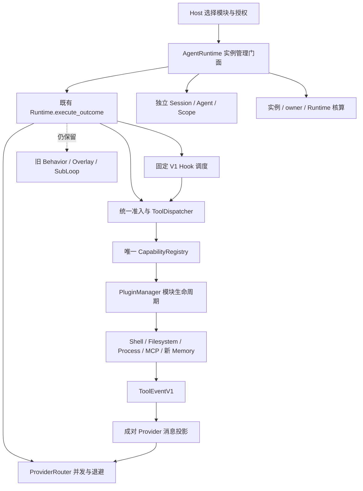

# Registry Kernel 最终收敛施工与验证账

[Document-Meta]
Document: docs/04-internal/kernel-convergence-2026-10-28.md
Version: 1.1
Last-Modified: 2026-10-28
Status: 本批已验证；整体 Convergence 为 Partial，未满足全部最终完成条件
Author: Codex

## 基线与边界

fetch 核实远端 KC、本地均为 `149291e7504f9a3928dd220010aa777f07a3acae`，工作区 clean。
工作分支 `codex/kernel-convergence-final`，不修改 main、不强推。
ADR-0018～0021 与现有 KC/Phase 3 交付账为设计与兼容边界。
历史全量结果不当作本轮实测；全量五段在最终源码稳定后运行。

## 内部依赖清单

| 工作 | 依赖 | 当前状态 |
|---|---|---|
| 分层任务作用域、有界停止、动态工具 owner | 既有 PluginManager / Dispatcher | Implemented / Wired / Tested |
| 动态 MCP 生命周期及描述符授权 | 上述所有权、既有 bridge/pipeline | Implemented / Wired / Tested；显式 shutdown 清理 |
| 独立 Agent Session/Scope/取消 | 所有权、既有 Runtime.execute | Implemented / Wired / Tested；11 项真实实例验收 |
| 实例/模块/全局请求核算、预算与 Provider 限流 | 独立实例、实际请求边界 | Implemented / Wired / Tested；未知用量与估算费用明确分开 |
| Memory tools + 固定 V1 Hook + 后台整理实例 | 独立实例、Namespace 授权、既有 Memory 存储 | Implemented / Wired / Tested；新 Host 组合；默认桌面替换 Partial |
| Profile 持久配置与授权绑定 | 通用身份与实例机制 | Implemented / Wired / Tested；通用 Host API |
| Legacy / Host / Android / 最终回归 | 上述接线与现有平台组合 | 待最终验收；不把接口当交付 |

## M1 实际接线

- 一个 PluginManager、一个 CapabilityRegistry。动态工具仅在 owner 声明的 namespace 下发布；
  catalog 原子替换并撤销旧代执行 scope，旧句柄不能继续调用。
- 子作用域的调用/native lease 同时登记到父模块。撤销子工具不取消同级工具；停止父模块会取消所有后代。
- stop 的 Stopping 检查点在排水前落下。有界 stop 超时保留资源 owner/错误，不允许 unregister；资源释放后可重试。
- Dynamic MCP 是普通 McpPlugin。初始化/发现、更新、连接关闭、读取任务 abort+join、stdio 进程回收归其所有。
  可选 MCP 失败记 Failed/错误并清理，其他独立模块可继续；默认必需 Plugin 的启动失败语义不变。
- ProductionModules 的 MCP 开关现在注册 McpPlugin；旧 McpModule bag 构造接口保留兼容，非生产目录真源。
- 重连 pin 工具 Schema/只读声明，漂移后拒绝旧调用而非盲重试；审批冻结描述符快照。
  Schema/风险改变后必须刷新目录并重新授权；只读预设不得保留为后续写能力的授权。
  显式 Host allowlist 按原配置授予；被自动预设覆盖的临时手工授权需在风险变更后重新确认。
- 原生 stdio 复用 Unix 进程组与 Windows Job Object 机制。Linux 实进程清理已测；不声称 Windows/macOS 硬件已验证。
  Unix 仍为既有 PARTIAL 遏制等级，主动脱组后代不在强隔离承诺内。

## 验证记录

2026-10-28，Rust/Cargo 1.97.1、PowerShell 7.6.0、Linux Cloud，jobs=2。
沿用 Phase 3 仓外工具链环境及 subreaper（只回收已死孤儿，不修改测试/信号/退出码），不改门禁脚本。

- `cargo test -p apeireth-plugin -p apeireth-runtime --all-targets --locked -j 2`：31 suites / 643 passed / 0 failed / 0 ignored。
  日志 `/workspace/scratch/apeireth-convergence-m1-runtime-tests.log`。包含 2 项新所有权/超时回归。
- 真实 MCP Runtime 已验证发现→调用→V1 归属→目录变更→失效句柄→重连→停止→卸载→重新注册；
  活跃调用取消、可选失败隔离、Linux stdio 主进程/后代清理及描述符授权漂移另有回归。
- 原 Phase 3 的 24 项 Runtime 验收与旧 MCP 4 项 Runtime 验收通过；原断言未改变。
- 严格架构检查 violations=0；没有新增架构例外、依赖边或环境开关。
- 新增 MCP 验收 5 passed / 0 failed，旧 MCP bridge 14 passed / 0 failed；安全变更后的 scoped Clippy -D warnings 通过。
  日志 `/workspace/scratch/apeireth-convergence-m1-mcp-final.log`、`apeireth-convergence-m1-mcp-security.log`、`apeireth-convergence-m1-clippy-final.log`。
- 全量门禁、Android 和前端兼容检查留待最终集成后执行，未提前记通过。

原始问题：冻结描述符的 display 参数初次使用字符串而非 JSON Value，编译报类型错后按原接口修正；
未削弱 schema、权限、描述符或原断言。

## Git 与退出条件

每个稳定内部单元创建提交后自动继续，不请求阶段批准。最终事实声明 verified_at 必须指向实际源码提交。
推送前 fetch；403 只尝试一次，不变更凭据，导出相对本基线的已验证增量 bundle。
最终必须补齐各功能 Implemented/Wired/Tested/Partial/Not Implemented、真实测试结果、提交与远端状态。

## M2 实例与资源核算接线

`RuntimeBuilder.build_agent_runtime(AgentHostPolicy)` 构建既有 Runtime 的实例门面；
`AgentRuntime.spawn_agent(owner, AgentConfig)` 创建新 Session/Agent，不复制 Loop。
模块从 `PluginContext.agents` 获得绑定 ModuleInstanceId 的端口，默认空工具范围；
Host 显式配置 `ModuleAgentGrant` 的工具、Principal、实例数、深度、预算与安全上下文。
`AgentInstance.run/pause/resume/stop/destroy` 分别提供独立历史、回合边界暂停、取消、排水与回收。

- Agent 与工具模块的任务 scope 组成去重所有权 DAG；原生 lease 同时归属调用实例及工具模块。
  Agent stop 等待原生工作退出，模块停止传播到其拥有的实例。旧 Agent handle 不会延长 Host 生命周期。
- 并发请求使用 Runtime 共享读锁，不以全局互斥串行化；Provider 配置独立 semaphore。
  可重试失败退避 100ms 起、上限 5s，尊重更长 Retry-After，等待可取消。
- 真实 Provider attempt 在请求边界记账；Session/Agent/Module/Runtime 视图不相加重复计费。
  每实例保留最多 64 条请求事实，累计账独立保留；Host 默认最多 16 活跃、256 审计记录。
  配置的 token/cost 预算约束下一请求，输出上限按剩余额度收紧；不承诺上游报告无法预知的绝对零超支。
- Usage 未报告、cache 未报告、未配置价格分别为未知；费用来自既有价格表估算，不是上游账单。
  Provider 错误尝试仍记录请求与未知 usage；成功请求缺失 usage 时拒绝后续预算调用。
- Managed Runtime 默认 V1，包括无业务模块时的未知工具错误；Raw Runtime 的旧日志 ABI 保持兼容。
- 控制面模块 stop/unregister 使用有界排他窗口；不强称长请求期间任何控制操作都无等待。
  模块创建端口在 Host assembly 完成后可用，initialize/start 中不能同步等待创建。

验证：相关全目标回归 95 suites / 1156 passed / 0 failed / 0 ignored（含当时 10 项实例测试）；
增加 Retry-After 验收后的实例测试 11 passed / 0 failed；四 crate 全目标 Clippy -D warnings、fmt、严格架构检查通过。
日志 `apeireth-convergence-m2-regression.log`、`apeireth-convergence-m2-final.log`、
`apeireth-convergence-m2-clippy.log`，均在 `/workspace/scratch/`。
以上为 M2 提交时状态：当时 Profile/Memory 尚未交付；后续 M3 的实际状态见下。

## M3 注册式 Memory / Profile 纵向切片

新增文件集中在 runtime `profiles.rs` / `instances/profiles.rs`、assembly `memory_module/*` / `profile_store.rs`。
没有新 crate、Cargo 依赖、数据库重建或桌面功能删除。

| 功能 | 状态与边界 |
|---|---|
| 新 MemoryModule 的 7 个工具 | Implemented / Wired / Tested（真实 Runtime）；Desktop 默认替换未完成 |
| BeforeModelCall 自动检索 | Implemented / Wired / Tested；固定 V1 Hook、每 request 幂等、成对 Provider 投影 |
| Namespace 私有读写 | Implemented / Wired / Tested；仅受信任 ToolExecutionContext.principal，不接受模型 namespace 参数 |
| 后台记忆 Agent | Implemented / Wired / Tested；独立 Session/Usage/Scope，可与主请求并发；stop/unload 取消清理 |
| Profile 配置、CAS 持久化、单主切换 | Implemented / Wired / Tested（Host API + SQLite）；没有 UI 或产品人格逻辑 |
| 模块启动后自主创建 Agent | Implemented / Wired / Tested；ModuleAgents.wait_ready，无 Host 工具触发也能启动 |
| 原始 Memory 数据迁移到新 Namespace | Not Implemented；不擅自将旧私人数据归属新身份 |
| 旧自动 Memory / Persona / Organ 全部改 V1 | Not Implemented；成熟生产兼容路径保留，见退出清单 |

调用路径：

```text
Host-selected Plugin + AgentConfig(principal, tools, budget)
  → PluginManager initialize/start
  → AgentRuntime → existing Runtime.execute_outcome → existing SessionManager
  → fixed BeforeModelCall → MemoryModule.on_hook (immutable snapshot)
  → registered memory_retrieve → normal admission/schema/scope/governance/dispatcher
  → module-owned DB worker lease → existing MemoryCoordinator/backend/governance
  → ToolEventV1(Module, module.memory, fixed execution ID)
  → existing paired Provider adapter projection → model

Model memory_organize → same Dispatcher → owner-bound ModuleAgents.spawn_agent
  → own Session + tools(memory_retrieve, memory_write) + own usage/cancellation
  → same existing Runtime.execute_outcome → authorized namespace append
```

工具 ID 为 `tool.memory.retrieve/write/update/delete/search/compact/organize`；模型名称使用
`memory_retrieve` 等下划线名称以适配 Provider 的工具名称约束。Namespace 不是工具名权限。
查询预算同时受字符上限及 TokenMeter 估算限制；未报告的真实 usage 不由估算冒充。
查询空结果正常返回空 items；DB 错误、权限拒绝、取消、预算超限返回结构化错误，不能升级为 System 消息。

写入是追加式；同 Namespace/idempotency_key 重试返回既有 ID，内容冲突拒绝，不复活已遗忘记录。
进程内模块写互斥与既有 SQLite append-only/CAS 维持一致性；不将可选 metadata sidecar 声称为跨后端分布式事务。
更新/删除要求 expected_revision，并沿用受保护拒绝和冻结审批；后台实例不开放这两个工具。

## Host API 示例

```rust
// Provider Plugin、governance 和 principal 均由 Host 配置，模型不能替换。
let memory = Arc::new(MemoryModule::new(coordinator, clock)
    .with_recall_token_budget(1024));
let mut policy = AgentHostPolicy::default();
policy.modules.insert(memory.manifest().id.clone(), ModuleAgentGrant {
    tools: ["tool.memory.retrieve", "tool.memory.write"].into_iter()
        .map(|id| CapabilityId::new(id).unwrap()).collect(),
    principals: vec![principal.clone()],
    ..Default::default()
});
let runtime = Runtime::builder().with_plugin(provider_plugin)
    .with_plugin(memory).with_governance(host_governance)
    .with_default_model(model).build_agent_runtime(policy).await?;
let main = runtime.spawn_agent("main", AgentConfig {
    principal: Some(principal), tools: allowed_main_tools, ..Default::default()
}).await?;
let reply = main.run("hello".into()).await?;
main.stop().await?;
runtime.shutdown().await?;
```

模块从 PluginContext 保存 `agents` 端口；在有 owner 的后台任务中等待 `wait_ready()`，
再调用 `spawn_agent(config)` / `run(task)` / `destroy()`。本批 Runtime 测试包含不依赖主工具调用的自主启动。
Host 可以完全不注册 Memory、Shell、Filesystem、MCP；默认 Kernel 不自动安装高权限工具。

## 必须保留的 Legacy 退出清单

| 入口 / 实现 | 当前实际准入和行为 | 风险、测试及退出条件 |
|---|---|---|
| ProductionCognitiveModules.register_into → with_module；cognitive.rs MemoryRecall/Writeback | 旧 BehaviorRegistry Hook，仍有 PromptOverlay；新 MemoryModule 不会自动替代它 | 不可同时对同一业务重复写回；保留 production_integration/cognitive_vnext/memory 回归；将调优、typed sink、materializer、consolidation、Persona 等语义逐项映射为注册工具后替换 |
| OrganModule / PersonaConstantInjection / PreferenceRecall | 旧业务 Overlay/直接存储接口 | 未证明新 Namespace 隔离，不应与私有 Profile 混合装配；迁移前仍为桌面既有兼容模式 |
| RuntimeSubLoopSpawner / RuntimeModuleInvoker | 独立旧临时 transcript；工具仍经 Dispatcher，provider 侧调用已接同一 session 核算 | 不冒充模块拥有的 Agent；保留 subloop/模块 ABI 测试；需逐调用点迁到 ModuleAgents 后退休旧算法 |
| with_tool / with_capability / invoke* | 已有 LegacyToolAdapter 进入唯一目录和准入；可保留公开 ABI | 不是第二注册表；逐工具补完整 output schema，而非删除成熟工具 |
| Raw Runtime 非 V1 日志 | 为既有公开日志 ABI 保留；Managed Runtime 强制 V1 | 旧消费者迁完后才能默认切换，不修改历史事件 |
| after-tool barrier | 关闭且排空的 V1 模块不再触发 barrier；运行中有订阅仍保留确定性屏障 | 未将可启动 Agent 的观察器假定为无副作用；进一步缩小需要显式并发/提交契约及回归 |
| 控制面热注册/刷新 | Raw Runtime 支持生命周期目录更新；Managed 门面当前只提供有界 stop/unregister/shutdown | 未提供任意模型请求中无阻塞热注册；应补 owner port 重绑定与 generation 测试 |
| 隐式 Drop | Agent Host 最后句柄取消实例；原生 transport Drop 有终止兜底 | 可保证完整 drain/join 的入口是显式 shutdown；外部长期持有 MCP definition/bridge Arc 的放弃路径尚需同步撤销设计与测试 |

这些是未完成的真实目标，不标为完成，也不通过删除旧测试或弱化断言规避。

## 本批验证中的修正

- 后台 Memory 卸载测试揭示控制写锁重入读锁死锁；Agent 销毁改为直接使用 SessionManager 端口。
- 单测初次以不存在的 JSON origin 字段断言既有 ToolEventV1；改用原有强类型 source() 匹配 Module，并验证工具消息承载检索内容。未改协议。
- 新 Profile 存储初次误将同步 read 当作 Future，编译拒绝后改为 spawn_blocking + 既有池 API。
- Clippy 要求 let-else，按原 lint 修复；没有加 allow、ignored、改安全策略或架构例外。

桌面前端本批实测：svelte-check 0 errors/0 warnings；82/82 suites；11 项素材许可；Vite build 通过。
构建保留既有 bundle size 警告，未改变分包阈值。
Android Runtime lib 的 `aarch64-linux-android` cargo check 已通过，未声称运行 Android 硬件或完整 assembly。

M3 相关全目标回归：98 suites / 1449 passed / 0 failed / 0 ignored（新增最终两项验收前）。
最终聚焦验收：12 项 Agent + 9 项 Memory/Profile，全部通过；五 crate 全目标 Clippy -D warnings、fmt、strict arch 通过。
日志：`apeireth-convergence-m3-regression.log`、`apeireth-convergence-slice-final.log`、
`apeireth-convergence-clippy-verified.log`、`apeireth-convergence-arch-verified.log`。
最终全量五段仍待运行，不以这些聚焦结果替代。

架构登记修正：初次把 owner 服务/存储端口归入扩展点导致严格守卫拒绝。
按 ADR-0021 复核：两者与 Clock/SessionStore 同类，经既有 PluginContext/Host 注入，
不接收模块注册、不构成第二扩展系统；改为唯一 canonical 概念登记。未改守卫或棘轮基线。

## 本批实际结构



Facade 不复制 Loop；ProfileStore 是 Host 存储端口；MemoryCoordinator 继续拥有成熟的存储与治理。
Usage 按实际 request attempt 记录 token/cache/latency/error/cancel；费用是价格表估算。
owner 汇总目前区分具体 ModuleInstanceId，跨重启 definition 级视图仍需 Host 合并，不能将其描述为精确账单。
新 API 已接线并测试；默认桌面旧认知管线、Managed 在线热注册和放弃持有外部 MCP Arc 的清理仍为 Partial/Not Implemented。

## 系统场景证据映射

| 场景 | 真实执行证据 | 限制 |
|---|---|---|
| A Minimal | convergence_agents 无工具 V1 错误、无模块对话；convergence_memory 无 Memory 仍对话 | Provider 使用离线 fixture |
| B Complete Tool | Phase 3 capability_modules_v1 与本批 MCP/Memory 的 Dispatcher→V1→成对投影 | 四 Provider Adapter 都校验实际请求；无真实 API |
| C Memory Hook | convergence_memory 的自动检索/工具内容、source=Module、无 System 拼接 | 新 Host 组合；不是默认桌面替换 |
| D Background Memory | 独立 organizer 完成 retrieve/write；主 Agent 在 child Provider 阻塞期间仍完成回合 | 模型内容用确定性 mock |
| E Concurrent Agents | convergence_agents Barrier 同时进入 Provider、不同 Session/Scope/usage、单实例取消、Provider 限流 | 不声称无限并发 |
| F Stop/Unload | owned_lifecycle、convergence_mcp、convergence_memory 活跃任务取消及原生资源排水 | Drop 放弃路径仍有明确技术债 |
| G MCP | 动态发现/替换/断线/重连/stop/restart/unload、描述符冻结、Linux stdio 清理 | Windows/macOS 仅既有条件编译实现，未硬件测试 |
| H Profile | 私有 Namespace、跨空间修改拒绝、持久配置 CAS、单主切换、Session reload/fork Scope | 无 UI；旧私人数据不自动认领 |
| I Desktop | 既有 workspace 回归与前端 82 suites/check/assets/build | 未运行 Tauri 原生窗口或真实设备/API |
| J Android Core | aarch64-linux-android Runtime lib 交叉检查；Linux 无业务模块模拟运行 | 未运行 Android 二进制、未编译全部桌面 assembly |

所有新场景均使用可重复、无外部 API 的 Provider/受控临时 SQLite/无害本机进程。
最终五段结果以下方最终证据为准。

## 尚不能满足最终完成定义的边界

- 旧生产认知路径没有全部进入 V1/权限入口；不允许把新 Host 的场景测试冒充旧默认路径已经迁移。
- PluginId / ModuleInstanceId / AgentId / invocation 已分开，但既有 Plugin trait 仍把声明与资源对象放在同一个 Arc。
  Host 必须为各 Runtime 构造独立的有状态 MCP/Memory Plugin；本批没有提供可跨 Runtime 安全复用的 definition→instance factory。
- 显式 shutdown/stop 的排水与 MCP 原生清理已测；外部长期持有 bridge/definition Arc 时，
  丢弃 Runtime 的同步撤销机制未完整实现。不能将最佳努力 Drop 当成已完成的异步清理证明。
- Managed 控制面尚未提供完整在线注册/刷新/restart；当前门面可停止/卸载，Raw Runtime 保留这些既有控制 API。
- 新 Memory 不默认导入旧 Global/Persona 数据；未写跨身份迁移授权适配，也未将桌面全量调优/物化/Organ 迁完。
- 新 Memory 工具使用共同输入 schema 和结构化结果，但精细 output schema 声明及 Native 取消以外的存储故障注入仍需补齐。
- Android 证据止于通用 Runtime lib 交叉检查，桌面 assembly 的依赖裁剪和完整 Android Host 尚未验证。

这些工作超出本批已验证切片的执行预算；保留既有桌面语义与可恢复提交，不以大批未验证改写追求形式上的零 Legacy。
下一次施工应先做生产 Memory 兼容 Adapter（保留调优/typed sink/provenance），并建立 definition/instance 资源工厂和撤销式 Drop，
再用 ModuleAgents 替换旧 SubLoop 调用点、补 Managed 在线生命周期控制，最后重新跑完整验收。
在这些边界关闭之前，本任务的最终整体状态只能是 Partial。

Provider 成员变更沿用既有 Runtime 不可变路由约束：只能经 Runtime shutdown/rebuild 完成。
Managed 的模块停止/卸载控制当前应限工具/Hook 模块，不是运行中的 Provider 热替换 API。
ProfileStore/AgentRuntime 是受信任 Host 端口；外部用户到 Session 的访问授权仍由既有 Host/domain governance 负责，
不能把存储的 Principal 当成外部请求身份认证。

## 最终源码与全量验证记录

验证源码提交：`bbb7b58625043a204859bc42a758819bed26cd1d`，其父链包括
`067bd3773d90f90e514203ef5ef232cca78a293f`（MCP/资源）与
`4682c578b48e2ecac8d2d0d312023a29d5be9aea`（实例/核算）。

2026-10-28，原始 `pwsh scripts/gate_full.ps1 -Log logs/gate-full-kernel-convergence-2026-10-28.log`
实际退出 0：**358 suites / 9004 passed / 0 failed / 51 ignored，GATE FULL PASSED**。
main.cargo-test、main.clippy、main.fmt、image.cargo-test、image.clippy 五段全部 OK。
相对历史 Phase 3（354 / 8976 / 0 / 51），增加 4 个 integration suites 和 28 个实际测试：
所有权 2、MCP 5、Agent 12、Memory/Profile 9；未删除测试或增加 ignored。

- Rust/Cargo 1.97.1，PowerShell 7.6.0，Linux Cloud，jobs=2；dev/test debug=0，但 debug assertions 保持启用。
- source freeze 的 3223 个 Rust/Cargo 文件 SHA256 在完整门禁前后逐一一致；后续仅文档改动。
- Gate 原始日志 SHA256：`7485e36b9ea35b70771709a765d089beaac9e485f40a035d7fe4a66441755792`。
- `cargo check -p apeireth-runtime --lib --target aarch64-linux-android --locked` 通过；
  `cargo build -p apeireth-runtime --lib --target aarch64-linux-android --locked` 也通过，产出目标库。
  正常依赖树不含 tools-canonical / memory / organ / runtime-assembly；没有完整 App/JNI/设备运行结论。
- 桌面前端 check 0 errors/0 warnings，82/82 suites，素材许可 11 项，Vite build 通过；保留既有大 bundle 警告。
- strict arch 0 violations；docs truth 32 claims / fail=0 / stale=0 / review_due=0；wiring crosscheck strict 0 problems，links 0 断链。
- 原生 stdio 进程与后代清理在 Linux 实测；未虚构 Windows/macOS、真实模型 API、Android 或 Tauri 设备验证。
- 第一次独立恢复基库从 Cloud 部分克隆复制失败（缺失旧 promisor 对象）；改从远端拉取基准后 full fsck 通过。
  三个代码提交的增量 bundle 已独立 checkout，并验证 3223 个冻结文件完全一致；最终文档提交加入后再验 bundle。

主源码六 crate 修改：foundation/core、foundation/plugin、engine/runtime、engine/runtime-assembly、engine/memory、capabilities/tools。
无新增 crate、Cargo 外部依赖/feature/版本变化、无安全依赖批量升级、无 LOCKED 或 R11 修改，未修改 main。
Rust 公共结构新增可选 principal/scope 字段：序列化旧记录以 default/skip_none 兼容；外部裸 struct literal 构造者需补 None，
推荐继续使用 Session::new / PluginContext::new / AgentConfig::default 等构造入口。

整体不宣布完成：默认桌面 Legacy Memory/Persona/Organ 与旧 SubLoop、definition→instance 工厂、放弃外部 Arc 清理、
完整 Managed 热生命周期、旧记忆授权迁移及 assembly 的 Android 裁剪未在本次执行预算内完成。
已验证代码与现有桌面保持兼容，剩余风险及退出条件见上表；没有用空实现或关闭门禁代替交付。

## 远端交付阻塞与恢复

完成文档提交 `eb2a28808a6db44ff7465ef694160a7c4adb9922` 后再次 fetch，
远端 `refactor/kc1-kernel-convergence` 仍为 `149291e7504f9a3928dd220010aa777f07a3acae`，
已通过 ancestor 检查，工作区 clean。唯一一次安全推送返回：
`Permission to Apeireth/Apeireth.git denied to Jimmyxiao2009` / HTTP 403。
未重试推送、未更换凭据、未强推、未修改或合并 main。

因此本批成果只在本地提交中，不标为远端已交付。
最终 HEAD、完整提交清单、bundle SHA256、独立恢复校验及原始门禁日志随仓外 delivery manifest 提供。
增量 bundle 仅依赖上述远端基准；新提交原样保留。

在有写权限的环境中恢复（先核对 manifest/bundle SHA256）：

```bash
git clone --branch refactor/kc1-kernel-convergence https://github.com/Apeireth/Apeireth.git Apeireth
cd Apeireth
git bundle verify /path/to/apeireth-kernel-convergence.bundle
git fetch /path/to/apeireth-kernel-convergence.bundle refs/heads/codex/kernel-convergence-final:refs/heads/convergence-import
git merge --ff-only convergence-import
git fetch origin refactor/kc1-kernel-convergence
git merge-base --is-ancestor origin/refactor/kc1-kernel-convergence HEAD
git push origin HEAD:refs/heads/refactor/kc1-kernel-convergence
```

任一基准/快进检查失败，应检查新提交并重新验证；不要强推或自动合并 main。
这里只提供恢复说明，不再次尝试当前被拒绝的推送。
