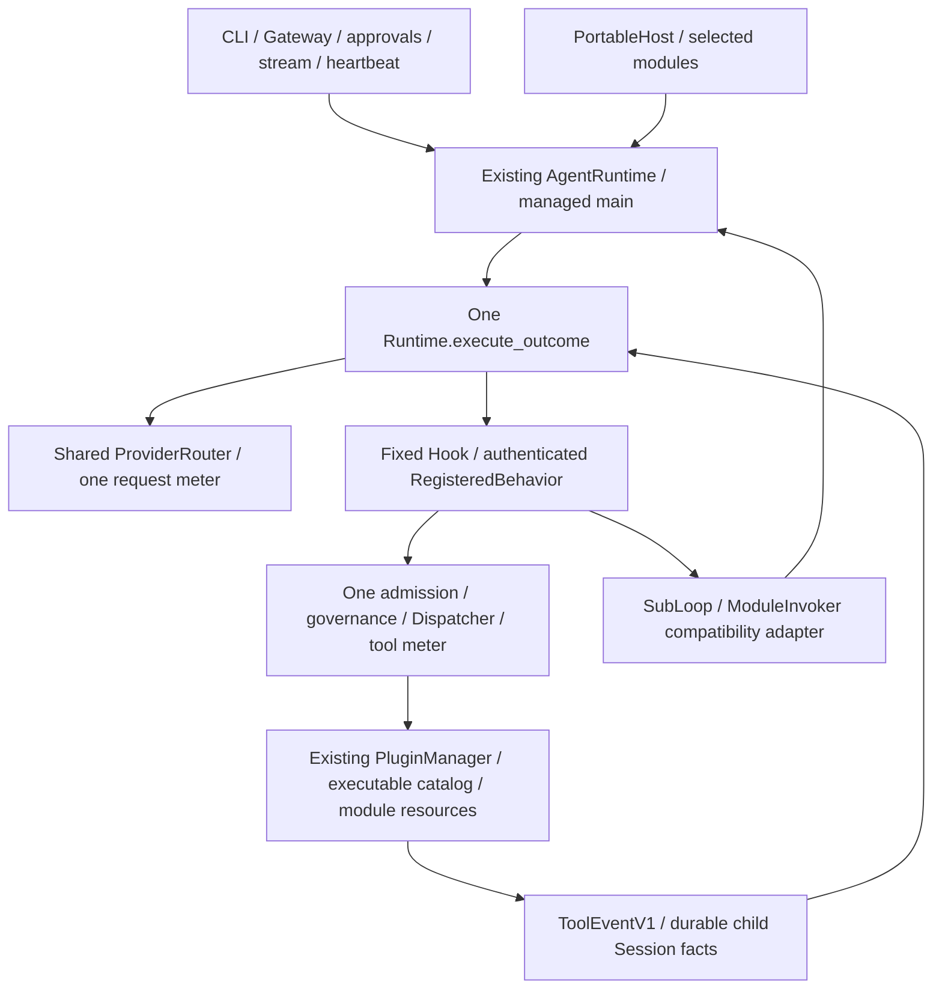
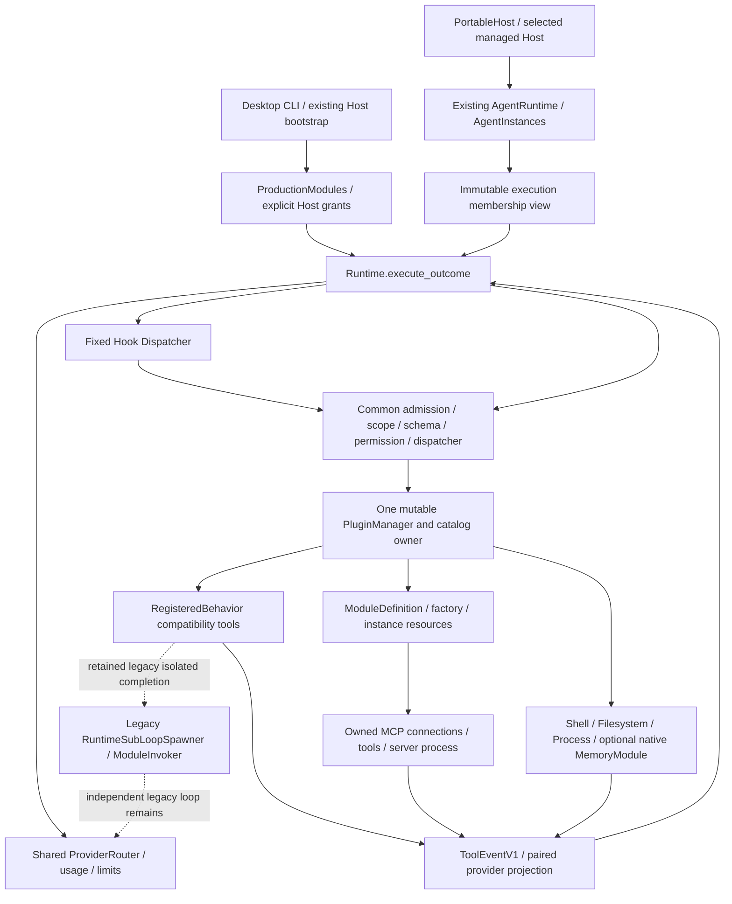

# Kernel Convergence Final Acceptance Report

[Document-Meta]
Document: docs/04-internal/kernel-convergence-final-acceptance-2026-10-28.md
Version: 3.1 (S6 Android cross-check addendum)
Last-Modified: 2026-10-29
Status: Convergence Partial；S1–S6 软件门禁通过，冷启动目标仍未达
Author: Codex

## 2026-10-29 当前验收结论

**整体仍为 Partial。** S1–S6 的兼容执行收敛为 **PRODUCTION WIRED**，原五段软件门禁通过；
现存 Complete 阻塞项是既有冷启动目标未达。不会把基准进程 exit 0 当作性能阈值通过。
本批 Android 库交叉复验已通过：runtime 库 check/build、assembly 最小库 check 均 exit 0；
范围仅为库编译，不代表设备/JNI/UI 或 HARDWARE VALIDATED。

当前分支为 `refactor/kc1-kernel-convergence`，起点 clean `c303af09`，S6 源码冻结在
`3f8048e8d8fca86eceba0e6e2eda89a16eed5ce1`，已 fetch 后快进推送。
本批不修改 main、LOCKED、workspace.version、Cargo.lock 或外部依赖；源代码与文档分提交。
精确命令、日期、工具链、逐项数字、首次环境失败与最终日志见
[S6 交付账](kernel-convergence-s6-2026-10-29.md)。本文下半部历史原文完整保留。

| 范围 | 当前状态 / 证据 | 仍需区分的边界 |
| --- | --- | --- |
| M1 Production Cognitive / Profile | 兼容执行 PRODUCTION WIRED；S4 显式授权映射 IMPLEMENTED，真实 Runtime 对抗回归通过 | 映射由 Host 选择，未默认启用；无 principal 仍使用原库，未映射私有 principal 默认拒绝 |
| M2 Resource Factory | PRODUCTION WIRED；独立资源、回滚、旧代句柄与冻结审批回归通过 | 不重造工厂或共享资源所有权 |
| M3 Managed MCP / Hot Lifecycle | PRODUCTION WIRED；热替换、进程关闭、native drain 失败重试回归通过 | Drop 只撤销，显式关闭才提供排水结果；不是外部服务 live 实测 |
| M4 Legacy SubLoop Migration | PRODUCTION WIRED；S1 的真实独立实例执行，S6 持久工具事实 / 中断 checkpoint / 前端隔离 / 唯一核算通过 | ABI 保留，不保留另一个 provider/round 循环 |
| M5 Parallel Backend Elimination | PRODUCTION WIRED（旧模块执行入口范围）；S2 Invoker、S3 行为入口、S5 默认桌面 main 经同一实例 / Kernel / Dispatcher | 原兼容类型、显式 Host API 与既有日志 reader 保留；不等于所有产品命令均重写 |
| M6 Portable Assembly | IMPLEMENTED；最终源码 native minimal 与 memory,profile-store portable_host 通过；本批 Android runtime 库 check/build、assembly 最小库 check 通过 | assembly 本次仅 check；无设备/JNI/UI/HARDWARE VALIDATED |
| M7 Final Verification | 原 gate_full 五段、指定集成、前端、strict arch、文档真源 / 链接 / 索引通过 | 冷启动目标未达，整体验收 Partial |

当前执行关系：



取消持久记录使用子 request / trace 与真实 AgentId，原 AgentTaskStarted 关联 owner 世代与父来源。
AgentTaskInterrupted 的 pending calls 只说明最后 checkpoint 未闭合，不证明副作用未发生或已回滚，
不伪造 ToolResult、不额外扣账；显式排水成功才提供可观察事实，失败仍报错并保留 owner。
新枚举要求升级 reader；旧日志与旧事件保留，不能承诺旧二进制无损降级读取新记录。

## 当前门禁、性能和限制

原版五段 gate_full 最终 exit 0，完整日志与退出码为
`/workspace/apeireth-codex/s6-gate-full.log` / `s6-gate-full.exit`。
首次运行在编译时 ENOSPC，未执行测试，且退出码文件写入失败；原记录明确为 `UNRECORDED_ENOSPC`，不冒称通过。
只清理 incremental 与 deps 内超过 100 MiB 的构建产物后重试一次；没有 cargo clean 或改门禁。
最终五段 jobs=2，dev/test debug info=0、incremental=0，debug assertions 保留；Rust / Cargo manifest 前后一致。
具体全量数字只记在 S6 交付账，由 `s6-counts.py` 从日志复核，不代改 test-baseline 或 README 徽章。

2026-10-29，Linux x86_64 / rustc、cargo 1.97.1：
`CARGO_PROFILE_DEV_DEBUG=0 CARGO_INCREMENTAL=0 cargo run -p apeireth-bench-harness --locked -j 2 -- cold-start`
观测 P50 **17.4237 ms**，未达到原 **<10 ms** 目标；原 harness 默认样本与完整统计见 `s6-cold-start.log`。
同 profile 的 `-- idle-footprint` 观测 P50 **29.9922 MiB**，原 harness 判定达标，见 `s6-idle-footprint.log`。
这两个进程均 exit 0，但冷启动性能验收仍失败。沿用原完整生产组装口径，未为结果修改迁移、阈值、断言或持久化；
没有同环境 release 前后对照，不能据此断言 S6 引入性能回归。待机是小样本观察，不当作 Android 真机内存。

同日、同一 Rust/Cargo 1.97.1 工具链，`aarch64-linux-android` 库复验通过：
`apeireth-runtime` 的 `cargo check/build --lib` 与 `apeireth-runtime-assembly` 的
`cargo check --no-default-features --lib` 均使用 `--target aarch64-linux-android --locked -j 1`，exit 0。
原始日志为 `/workspace/apeireth-codex/s6-android-runtime-check.log`、`s6-android-runtime-build.log`、
`s6-android-assembly-check.log`，各有同名 `.exit`；完整命令见 [S6 平台证据](kernel-convergence-s6-2026-10-29.md#平台与验收边界)。
此前 `s6-android-status.log` 的 target 未安装记录是复验前快照，保留原样；不再代表本批最终结果。
本次没有 assembly build、可选 Memory/Profile 组合的 Android 构建或设备/JNI/UI 验证证据。

无真实外部 LLM API、外部 MCP 服务、原生桌面窗口或硬件联调结果。
Mesh/NAT/P2P 保留，PortableHost desktop-free；AfterToolCall 原串行屏障仍是已接受的调度限制。
后续完成冷启动目标的同口径验收；设备验证单独记账。整体保持 **Partial**，不能宣布 Complete。

## 历史正文（2026-10-28，原样保留）

以下全部“当前”“本轮”与状态指当时冻结代码及环境，不覆盖上面的 S6 现状。

# Kernel Convergence Final Acceptance Report

[Document-Meta]
Document: docs/04-internal/kernel-convergence-final-acceptance-2026-10-28.md
Version: 2.0
Last-Modified: 2026-10-28
Status: Convergence Partial；冻结代码全量门禁已通过
Author: Codex

## 结论与基线

本轮交付了生产认知兼容、资源工厂、受管 MCP/热生命周期和可裁剪 Host 的实际代码。
旧 SubLoop 执行器及旧全局认知数据的授权 Profile 映射尚未退出，不能宣布 Convergence Complete。
未实现部分没有用占位实现、删除测试、ignored 或关闭门禁冒充通过。

本地分支 codex/kernel-convergence-final。初始 clean HEAD 为
b33ba7e5bf35db5682882fb030403dca6b68a9b1；fetch 后目标远端 KC 也为该 SHA，已从用户记录的
149291e7 前进。前序五提交 067bd377 / 4682c578 / bbb7b586 / eb2a2880 / b33ba7e5
均存在并为初始 HEAD 祖先。本轮没有重造五提交、改 main、改 LOCKED、改版本或升级外部依赖。
main 保持 4ea9c26095e22b83dc30faaf8f7148ce7cbdb82c。

冻结代码 SHA：fc3e2c38eba058c76ebfe5b37f420171d40f66f6。五段门禁前后比较全部 3258 个受管 Rust/Cargo 文件的 SHA256；
最终文档提交可以位于其后，源代码须保持相同。恢复用完整 HEAD 与远端状态另由交付清单记录。

## Milestone 状态

| Milestone | 实际状态 | 验证范围 / 未完成条件 |
|---|---|---|
| M1 Production Cognitive Adapter | Implemented / Wired / Tested；Profile 映射 Partial | 桌面所选 Memory/Persona/Organ 回调已注册；旧全局数据不自动进入 private principal |
| M2 Module Resource Factory | Implemented / Wired / Tested | 现有 Registry 内独立实例、回滚、撤销、逆序关闭、失败重试；生产 MCP 使用该工厂 |
| M3 Managed MCP / Hot Lifecycle | Implemented / Wired / Tested | 模型等待期间可热替换；旧工具/审批失效；真实 stdio 子进程关闭不依赖 Arc 计数 |
| M4 Legacy SubLoop Migration | Not Implemented | 独立 spawn_bounded/provider 循环仍存在；需迁入 AgentInstance 并保留旧语义 |
| M5 Parallel Backend Elimination | Partial | 默认认知/MCP 已切换；with_module、旧 SubLoop/ModuleInvoker 后端仍需退出 |
| M6 Android Runtime Assembly | Implemented / Wired / Tested（交叉构建与 Linux Mock） | 最小库无桌面工具/组网依赖；可选 Memory/Profile；未做真机/JNI/UI |
| M7 Final Verification | Tested；整体发布结论仍 Partial | 五段、文档、前端、Android 与恢复通过；性能观察存在未达标项，见下文 |

没有新增产品 crate。修改的产品 crate 为 apeireth-plugin、apeireth-protocol、apeireth-runtime、
apeireth-runtime-assembly、apeireth-tools-canonical、apeireth-cli；Cargo.lock 和外部版本不变。

## 当前真实架构



两个公开 Host facade 使用同一个 Kernel 主回合算法。图中的 Legacy SubLoop 仍是必须删除的
独立执行后端；此图并未宣称桌面已默认改成 managed Main Agent 或所有子循环已统一。

## 生产认知路径和兼容性

ProductionModules.register_into → with_registered_behavior → RegisteredBehavior Plugin →
固定 Hook → module-only 注册工具 → 原 Memory/Persona/Organ 引擎 → ToolEventV1(Module) → 合法工具对。
CLI 使用 register_with_policy 明确授予其选中模块的内部 capability。Registry 本身不授予权限。

原 SQLite、检索排序、治理后的内容、typed sink、物化、调优和 Organ 业务对象保持。
回调凭证只在当前 session/request/trace/module 边界有效。模型看不到内部工具声明，准入层也拒绝
猜名调用，包含已获同名 capability 的情况。动态数据去除原 Overlay 的 system 角色，明确作为
不可信工具数据；静态 Host TurnRequest.system 仍是单独、可审计的策略入口。

引擎读取排除已认证模块投影的业务历史，避免将自己的记忆结果再次作为用户内容写回。
空观察只记录 V1 和 ModuleToolEventObserved，不制造空模型工具对或伪称已投影。
固定 Hook 追加 TurnStart、BeforeFinalCommit、OnError 以保持旧回调时序；SessionStart 仍每 session
一次，TurnStart 每 turn 一次。新增枚举记录要求升级 reader；ToolEventV1 字段与版本没有改动。

当前 principal 存在时，兼容 Adapter 不执行旧全局认知引擎，防止私人记忆泄漏。
Native MemoryModule 的 Namespace 路径可选装；旧数据/Persona 的授权 Profile 映射仍未完成。
这不是旧数据删除或迁库，也不能将 fail-closed 跳过描述为旧 Profile 完整兼容。

## Module API 与资源所有权

- ModuleDefinition：manifest、required_at_boot、dynamic_tool_namespace、instantiate。
- module_from_definition：创建一个普通 Plugin adapter，继续走现有 register/with_plugin/register_module。
- PluginContext.module_instance：读取 Registry 分配的 ModuleInstanceId；模块得到的是受限 agents 端口。
- ModuleResources：own、revoke、close、statuses；OwnedModuleResource：同步 revoke + 异步 close。
- Plugin.resource_statuses：查询关闭状态/错误；关闭失败保留 owner 并可重试。

一个 Registry 同时只接受一个 Module ID；同一定义可以在不同 Registry 或后续注册中创建独立实例。
初始化得到资源后应立即登记 ownership；失败回滚继续清理。关闭按逆获取顺序执行，逻辑撤销、
资源关闭和 Arc 对象内存释放相互区分。共享 Provider、Host 数据库池不得被自动当成模块私有资源。
Factory 工具包装器绑定实例激活令牌与 task scope，Start 前、Stop 后及旧 generation 均不可调用。
Factory 审批冻结 version + ModuleInstanceId + 原工具 FrozenInvocation，重启后不会继承旧审批。
非 Factory 旧工具的冻结 ABI 保持不变。

## MCP 和热生命周期

生产 MCP：McpDefinition → module_from_definition → PluginManager → 新 McpPlugin/bridge/connections。
Definition 只保留配置和当前实例的 Weak 观察，不持有共享活动连接。每次注册创建新 catalog、
连接和资源；新实例不复制旧权限 grant。用户仍须显式授权 MCP 工具，既有冻结/预设/拒绝机制保留。

连接 epoch/task scope 撤销 raw 与 managed 工具句柄；Stdio/SSE revoke 使 reader 和 pending replies
停止，explicit close join/reap。close 被取消或失败时保留 channel owner，便于重试。
保持外部 bridge/tool Arc 时依然关闭服务进程；旧实例不能借同名新工具继续执行。
Drop 只同步撤销；可观察的排水/关闭须调用显式 shutdown。

AgentRuntime 新增 register_module、refresh_module_tools；延续 stop_module/unregister_module。
控制修改串行、有界。Model/approval 回合在短读锁下获得不可变目录视图，随后释放读锁；Provider、
usage、dispatcher、session locks、event sink、metrics 和模块撤销令牌继续共享原对象。
视图是只读派生数据，不能自行注册/取消或在 Drop 时停止真实 owner。旧请求保留旧 scope，不能调用
替换实例；新 turn 才看到新目录。停止先验证依赖与 Provider 边界，再撤销并发布 Stopping、排水、
关闭。超时保留 Stopping 和 owner；重试可完成关闭，重复 stop/unload 安全。

兼容变更：配置预览使用 mcp_definition().config()/startup_log()；mcp_bridge() 在初始化后返回
Option<Arc<McpToolBridge>>，不再提供预构造的 Option<&Arc<...>>。原配置测试保留原语义，并增加
初始化前不创建 bridge/process 的断言。旧 McpModule bag 仅供显式兼容，不承担生产目录。

## 实例、Usage、Profile 与 Android

既有 ModuleAgents.spawn_agent / AgentRuntime.spawn_agent 创建真正独立 AgentInstance，run 进入同一
Runtime.execute_outcome。实例仍有独立 ID/session/context/scope/cancellation/state/errors/usage；
Host/module owner 级汇总、Provider 限流退避、预算和实际/未知/估算值区分保持。热注册获得同一工厂
生成的受限 ModuleAgents，停止 owner 取消其子实例而不关闭共享 Provider 或主 Agent。
Native MemoryModule 的后台 Organizer、七种 Memory 工具和 Namespace 隔离仍通过原测试；
旧认知业务通过 Legacy SubLoop 发起的请求尚不能冒充独立实例统计。

PortableHost 提供 assemble、submit、bind_profile、tool_scope、tool_events、snapshot、usage、cancel、
shutdown；Builder 继续注入 Provider、credentials、policy 和事件 sink。cancel 停止当前 main，
重新绑定才创建新实例；Profile 切换串行且不继承旧上下文，失败不回退到旧私有状态。
Memory/Profile 持久化可独立于 desktop 编译，默认不因编译 feature 自动注册业务工具。

| Features | 实际装配 |
|---|---|
| default desktop | 原桌面组合及公开路径，保留 Mesh/NAT/P2P 所在桌面 Host 功能 |
| no-default-features | PortableHost + 通用 Runtime，无业务工具默认注册 |
| minimal + memory | 可选 Namespace MemoryModule / 既有持久化依赖 |
| minimal + profile-store | 可选 SQLite ProfileStore |
| minimal + both | 上述两选项，不要求 Shell/Process/Organ/Gateway |

最小 normal dependency graph 不含 tools-canonical、memory、storage、organ、guard、gateway、SQLite；
没有桌面组网装配。Android 库 check/build 实际完成，不代表设备、JNI、Kotlin/UI 或真实 API 验证。
可选 SQLite 的 Android 目标构建需要目标 C 工具链；本轮对 optional 组合验证的是 native Linux。
完整 API、feature matrix 与代码例见 [Portable Runtime Assembly](../02-guides/portable-runtime-assembly.md)。

## Runtime 场景证据

| 场景 | 实测证据 | 状态 |
|---|---|---|
| A Production Cognitive | production_cognitive_v1：旧库、Persona、Organ、预算、单次工具注入与角色边界 | Tested |
| B Memory Disabled | production_cognitive_v1 / portable_host：禁用无旧回退、无 Memory 普通对话 | Tested |
| C Managed MCP | convergence_mcp / production_mcp_factory：目录、断线、停止/重启/卸载、外部 Arc 与进程回收 | Tested |
| D Factory Failure | plugin resource_factory + resource_factory_runtime：独立资源、失败回滚、重试与句柄失效 | Tested |
| E Hot Replacement | resource_factory_runtime：模型等待期间替换、旧响应/旧审批不能调用新代 | Tested |
| F Legacy SubLoop → Instance | 原 SubLoop 回归保留，但未迁入 AgentInstance | Not Implemented |
| G Owned Agent Shutdown | convergence_agents / convergence_memory：主 Agent 与后台独立运行、owner stop 取消子实例 | Tested |
| H Android Minimal | portable_host native Mock + Android target library check/build；无设备验证 | Tested within stated scope |
| I Desktop Compatibility | 新认知/MCP 生产 Runtime 接线 + 原 workspace/前端回归；未启动原生桌面 UI | Tested within stated scope |
| J No Hidden Path | 默认认知/MCP 正向证明；旧 with_module/SubLoop 仍存在，不提供虚假“零旁路”结论 | Partial |

## Legacy 剩余账及退出条件

| 输入入口 / 实际执行 | 当前语义和测试 | 风险 / 退出条件 |
|---|---|---|
| RuntimeSubLoopSpawner.spawn_bounded / invoke | 私有 transcript、自有 provider/round 循环、共享父 turn budget；原 SubLoop/治理/缓存 usage 回归保留 | 需 AgentInstance seeded-history、round/deadline/no-interactive-approval policy、父预算及结构化错误兼容后删除旧循环 |
| RuntimeModuleInvoker | isolated completion 兼容后端仍直接使用 router | 委托同一实例服务；不能把父 session Usage 当独立子实例统计 |
| RuntimeBuilder.with_module / ModuleOutcome.prompt_overlays | 非默认 Host 可走旧直接 callback/Overlay；生产 register_into 已不走此路径 | 将公开旧 API 也适配注册工具并迁移旧调用者/授权与消息语义测试 |
| with_capability / with_tool / LegacyToolAdapter | 工具路径最终进入既有 Dispatcher；部分调用者保留 legacy log 合同 | 保持冻结 ABI/安全后迁成 V1 日志；不能为零命名破坏公开兼容 |
| Desktop bootstrap → Raw Runtime | 主回合算法相同；默认主角色尚非 managed Main Agent facade | 保持 CLI/Gateway approval/session/domain 接口，切换到明确 Host-owned AgentInstance |
| 旧全局 Memory/Persona 与 private principal | 兼容 Adapter fail-closed；Native Namespace MemoryModule 另行可用 | 实现明确授权的数据/人格 Namespace 映射；不得自动跨 Profile 读写 |
| AfterToolCall 既有串行屏障 | 保留确定性与原有 scheduler 行为 | 后续按并行执行/有序提交拆分，需专门竞争与性能证明 |

本轮执行预算用于验证这些完整纵向切片；上述迁移没有在预算内完成。不是声称它们被 Cloud 禁止，
也不是已具备所有最终验收条件。尤其不能把 M4/F/J 的缺失描述成单纯文档待补。

## 实际验证

工具链：2026-10-28 UTC，Rust/Cargo 1.97.1，PowerShell 7.6.0，Linux Cloud。
Native jobs=2；dev/test debug info=0，但 debug assertions 保持启用；Android jobs=1。
外层 subreaper 只回收已死的孤儿子进程，不改变命令、断言、超时、exit code 或生产行为。
编译时磁盘接近耗尽，清理的是已产生同 package/target 新版本后的旧 ELF 测试二进制；
源码、编译库及运行中的程序未删除，清理清单在 evidence 内。

| 命令 / 范围 | 本批实测结果 |
|---|---|
| 原 pwsh scripts/gate_full.ps1 五段 | 363 suites / 9027 passed / 0 failed / 51 ignored；五段全部通过，exit 0，1705.457 秒，源码哈希一致 |
| Android minimal assembly target check + build | 两项通过；normal 依赖排除桌面工具/认知/组网装配与 SQLite |
| native no-default portable_host | 4 passed / 0 failed / 0 ignored |
| native memory,profile-store portable_host | 6 passed / 0 failed / 0 ignored |
| Clippy（各切片及两个可选组合） / fmt / strict arch | 通过；未加架构豁免 |
| Frontend check / test / assets / build | 0 errors / 0 warnings；82/82 suites；11 素材许可通过；构建通过 |
| Docs Truth / wiring / links / index / generated architecture | Docs Truth 32 claims / fail 0 / stale 0；wiring、links、index、generated architecture、strict arch 通过 |
| Performance | dev profile 冷启动 P50 21.7616 ms（30 样本，未达 harness 10 ms 目标）；独立进程待机 P50 26.7344 MiB（5 样本） |
| Independent bundle recovery + fsck | code bundle 已恢复；3258 Rust/Cargo 文件哈希一致；最终含文档 bundle 另行验证 |

前端打包器仍提示既有大 chunk；未因此更改门禁或无关依赖。没有真实外部 LLM API、外部 MCP 服务、
Android 设备/模拟器、原生桌面窗口或硬件联调结果。

本轮相对历史 b33ba7e5 的同口径记录增加 5 个套件和 23 个通过测试，ignored 仍为 51。
新增 production_cognitive_v1(4)、plugin resource_factory(4)、resource_factory_runtime(5)、
production_mcp_factory(1)、portable_host(6) 五个测试目标；既有 convergence_mcp 增 2，
convergence_agents 增 1。旧测试与断言保留；runtime 内嵌单测仅移到独立源文件，模块名和覆盖保持。

性能使用现有 bench harness，构建为 dev/debug-assertions profile，且在全量测试结束后独立采样。
冷启动没有达到 harness 显示的 10 ms 目标，不能记作性能验收通过；也没有同环境 release 前后对照，
不能据此断言重构导致了性能回归。额外执行 profile-cold-start 定位：初建 Memory schema 是主要成本，
内存库打开 P50 15.6847 ms、已迁移库重开 P50 1.9144 ms；细分模块构造/Runtime build 原始数值见日志。
没有为改善数值修改迁移、行为或阈值。待机样本少且为完整桌面 harness，不能当作 Android 真机内存。
实例创建、dispatch、Hook 延迟和长期增长没有专用前后基准，仍属未验证。

迭代日志保留原口径，不替代冻结全量：M1 runtime+assembly 97 suites / 1171 passed；
M2 plugin 3 suites / 287 passed；扩展 plugin/runtime/assembly 103 suites / 1471 passed（在最后
审批/native drain 验收追加前）；最新热生命周期/审批/生产进程 19 passed，MCP 7 passed。
每项均为 0 failed，日志区分各次执行，未将重复运行相加虚增总数。

核心日志前缀为 /workspace/scratch/apeireth-production-*、apeireth-portable-*、
apeireth-android-assembly-final-*；最终交付 evidence ZIP 提供原始日志、冻结 manifest 与门禁退出码。
最终全量数字只写本批实测，不改历史 test-baseline 真源或 README 徽章。

## Git 交付

本批代码提交：

```text
18ac7a62f3dcec2f1439120883c8ac284e6279a7 feat(runtime): dispatch production cognitive callbacks as registered module tools
0c16fb5fecc63ddd606458e4dc89fd1604eebd0a feat(plugin): own fresh factory resources and revoke instance tool handles
38c1d1a916c75a77bf0d4c3115219f0334ca62ee feat(runtime): supervise production MCP and hot module generations
fc3e2c38eba058c76ebfe5b37f420171d40f66f6 feat(assembly): compose a minimal portable host without desktop capabilities
```

只向 refactor/kc1-kernel-convergence 尝试安全快进推送；最终 fetch、远端 SHA、推送结果、
完整本地 HEAD、bundle SHA256 和恢复命令见随附交付清单。403 后不重试、不改凭据、不索取 PAT，
保留完整提交并在独立 full repository 验证增量 bundle 与 fsck。

KC/前序协议、Provider 配对、安全审批、原 DB 和桌面能力没有被删除；完整回归的实际结果以本报告
最终五段记录为准。最终完成定义中“所有旧子 Loop 与生产 facade 收口”尚不满足，结论保持 Partial。
