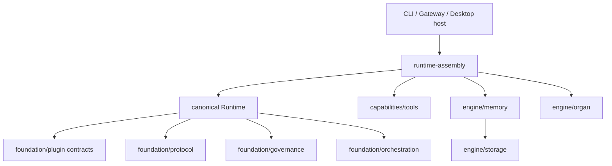
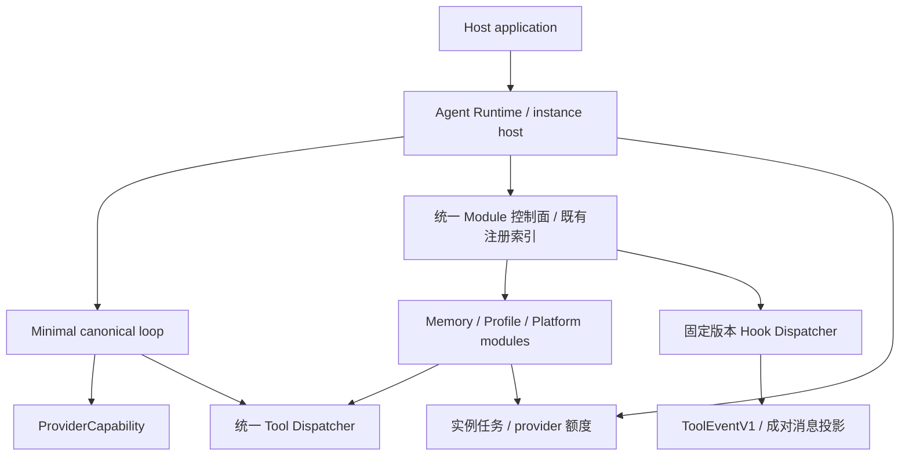

# Registry-Driven Agent Kernel：基线、审计与渐进迁移

```text
[Document-Meta]
Document: registry-kernel-migration-2026-10-27.md
Version: 1.0
Last-Modified: 2026-10-27
Status: KC 基线已确认；协议基础设施 IMPLEMENTED / 全量门禁通过；整项重构未完成
Author: Codex
```

## 1. Phase 0：远端与 KC 硬门禁

初始 Cloud `/workspace` 没有 checkout。本次克隆官方仓库到 `/workspace/Apeireth`，
执行 `git fetch --all --prune`，再次通过 `git ls-remote` 和后续 fetch 核对远端。

| 对象 | 分支 / SHA |
|---|---|
| 默认远端 | `origin = https://github.com/Apeireth/Apeireth.git` |
| 默认 main | `4ea9c26095e22b83dc30faaf8f7148ce7cbdb82c` |
| KC upstream | `origin/refactor/kc1-kernel-convergence@82724dc32f927f014e79c4d8aee20d769b87fced` |
| 本地工作分支 | `codex/registry-driven-kernel`，从上述 KC upstream 建立 |
| 修改前 HEAD | `82724dc32f927f014e79c4d8aee20d769b87fced` |
| 修改前差异 | HEAD/upstream ahead/behind `0/0`；工作树干净 |
| main 与 KC | left/right `0/8`；main 是 KC 的祖先，无分叉冲突，尚未合入 KC |

历史收口链的七个提交全部在远端 KC 分支可达：
`b419826c`、`052ea993`、`75ee2464`、`942dae1d`、`154bda68`、`7dad4c7c`、`f4a71b3e`。
另有 `82724dc3` 补修观察者 panic 隔离与 CI 自检。没有自行构造、补写或合并缺失提交。
这证明了这组已知交付已推送，**不能证明开发者电脑没有其他未公开工作**。

| 阶段 | 在 KC 远端提交中复核的实际内容 | 结论 |
|---|---|---|
| KC-1 | `plugin::observation` 通用事实；领域账本迁至 `organ::nociception`；runtime 旧领域文件/字段退役 | 存在 |
| KC-2 | `ControlCommand`、`PlanModeExitControl`、CapabilityRegistry 统一身份空间、启动期插件工具碰撞拒绝 | 存在 |
| KC-3 | `care_potential_field` 从 foundation 迁入 organ | 存在 |
| KC-4 | CLI/probe observer 绑定、`contract.toml [kernel]`、边界守卫和 6 项内核回归 | 存在 |
| KC-5 | [交付记录](kc1-kernel-convergence-baseline-2026-10-27.md) §5、CHANGELOG 收口项；本 Cloud 重跑五段全通过 | 已复现门禁通过 |

### 本次实测

- Linux Cloud；rustc/cargo **1.97.1**，PowerShell **7.6.0**。
- `gate_full.ps1` 原版五段全 OK，**GATE FULL PASSED**，退出码 0。
- 本次日志汇总：**351 套件 / 8907 passed / 0 failed / 51 ignored**。
  由日志 `test result:` 行逐项加总，不包括重叠的定向复跑。
- 日志：`logs/gate-full-kc-baseline-subreaper.log`，完成时间 **2026-10-27 17:42:25 UTC**。
- 主工作区：274 套件 / 6598 passed / 0 failed / 18 ignored；main Clippy、fmt 均通过。
- 定向 KC 测试二进制另跑 51 passed / 0 failed：kernel_boundary 6、bio_pain_wiring 4、
  canonical_plan_mode 5、organ nociception 24、care_potential_field 2、plugin observation 1、
  runtime capability 6、plan_mode_control 3。
- `arch_guard.py --strict` VIOLATIONS 0；`--self-test` 4/4 PASS；
  `docs_truth.py --verify` claims=29 fail=0 stale=0；wiring verify/crosscheck problems=0；
  文档链接断链 0、索引问题 0。

历史 `351/8902/0/53` 是另一时刻的记录，不作本次数字或门禁判据。
历史全量原始日志没有被 Git 跟踪，且 KC 记录早于最后的两项边界补修回归。

### 环境处置与原始失败

没有删除、弱化、忽略测试，也没有修改全量执行器。

1. Cloud 原无 Rust、PowerShell，安装仓库指定 Rust 及 PowerShell 到会话 scratch。
2. 首次构建缺 `dbus-1.pc`；从发行版开发包解压 D-Bus/systemd 开发文件，通过 `PKG_CONFIG_PATH` 使用。
3. 默认调试产物接近 32 GB 磁盘上限，主动中止并清理本次 target；随后使用
   `CARGO_BUILD_JOBS=2 CARGO_PROFILE_DEV_DEBUG=0 CARGO_PROFILE_TEST_DEBUG=0 CARGO_INCREMENTAL=0`。
   调试断言、测试和测试参数保留。执行器将主动 SIGTERM 的 143 泛化为 regression，不能当作代码回归。
4. 无正常 init 回收时，主工作区曾出现 1 项进程树测试失败：PID 38211 已是 zombie、PPid=1，
   容器 PID 1 为 `tail`；cgroup OOM/oom_kill 为 0，执行器宽泛关键词分类的 oom 没有实证。
5. 外部 Linux subreaper 只 `waitpid` 回收已死亡的收养进程，不发信号、不杀进程、不改变断言和退出码。
   原 process_executor 19 项全部通过；再包裹原版全量执行器取得上述五段通过结果。
   包装器位于会话 scratch，不是产品运行时、仓库测试修改或新的门禁执行器。

### 远端 CI 单独记账

对 KC HEAD 查询到 38 checks：36 success / 1 failure / 1 skipped。
[失败的 Secret scan](https://github.com/Apeireth/Apeireth/actions/runs/40472107622/job/122081424543)
停在安装 PowerShell，`Unable to locate package powershell`，扫描尚未执行；不能据此声称发现 secret。
[cargo-audit workflow](https://github.com/Apeireth/Apeireth/actions/runs/40472022773)
另有 failure，jobs 列表为空，根因未确认。**本地门禁通过不等于远端 CI 全绿，也不授权直接合入 main。**

已读取 AGENTS、工程宣言、施工纪律、贡献指南、架构契约与 ADR-0002/0008/0017。
LOCKED 锚/键集/脊柱/workspace.version/R11 基线不改；结构先 ADR；状态与索引走生成器。

**Phase 0 结论**：可以从已同步且已验证的 KC 分支开展本地渐进重构；不得从旧 main 开始。
若后续 upstream 改变，需重新比较差异。未推送或合并本批工作。

## 2. Phase 1：现有结构与迁移归属

下图是职责图；完整 111 条生产依赖边以
[生成依赖图](../architecture/ARCHITECTURE.generated.md) 为唯一真源。



| 子系统与源码入口 | 已确认现状 | 处理方向 |
|---|---|---|
| Runtime `canonical/execute.rs` / `runtime.rs` | 唯一会话状态机、治理/审批/预算/并行收口；零业务模块测试通过；生产依赖白名单为 foundation 五包 | 保留唯一执行主干；将通用服务从大文件抽离，业务扩展不加分支 |
| `BehaviorRegistry` / `CapabilityRegistry` / `PluginManager` / `ExtensionCatalog` | 行为顺序与唯一 ID、工具/控制身份空间、插件 DAG/生命周期/能力索引已存在；职责未收敛成目标统一生命周期 | 在现有控制面加 facade/适配，禁止第四份同义注册表 |
| `PluginManifest` / `PluginContext` | id/version/capabilities/dependencies；初始化失败会中止 boot，已启动者仍 Active；shutdown 反序且继续收尾 | 增加显式隔离策略、资源作用域、可取消卸载；保留默认启动行为兼容 |
| `module.rs` Hook / `PromptOverlay` | 8 个既有回合钩子，按注册顺序调用；Stop > Retry > Continue；内容主要是临时 system overlay | 分版本迁移结果到 ToolEvent；不能把 TurnStart 冒充 SessionStart |
| ProviderRouter / engine/provider | 路由、健康与回退；三类生产 provider 不等于四种协议适配器均生产接线 | 保留 ProviderCapability；并发额度按 provider 管理；传输与内容注入分离 |
| canonical Anthropic provider | 明确拒绝 tool declarations、tool calls/results，当前为文本路径 | 单独升级传输并验收后才可接受模块自动结果；协议适配器单测不能代替此接线 |
| Tools / `tool_modules.rs` | 已有 ShellModule、FilesystemModule、RepoModule 等 CapabilityProvider；进程执行在 tools crate；主 Loop 不直接跑 Bash | 保留成熟实现，统一 owner/lifecycle/Dispatcher；无 Shell 注册配置应无法发现或执行 Shell |
| `subloop.rs` | 私有临时 transcript、工具白名单、治理与超时；共享父 ModuleTurnState 预算；工具经自身 dispatch 调用 | 保留实现；并入统一 Dispatcher 后补实例 ID/会话/取消/统计，不能直接改名为独立 Agent |
| Session / event_log / quota / metrics | append-only 事实与派生视图、每 session 锁与账本、计量中未知字段不造 0 | 作为实例级状态基础；汇总不丢实例明细，不新建全局模型调用锁 |
| Memory / MemoryBackend / cognitive recall/writeback | 双时间事实、混合检索、持久化及现有工具成熟；自动 recall 仍走 overlay | 保留 DB/算法；检索、写入、更新、整理通过模块工具与固定 Hook 接线 |
| Persona store / persona_layer / companion | persona profile 现以 `(persona_id, subject_id)` 持久化；已有关系/人格注入；桌面为独立 Tauri workspace | 适配 Profile 服务与 Memory Namespace；默认单主角色，不把现有 persona profile 等同于完整 Profile Adapter |
| Heartbeat / durable schedule / task_queue / CallScheduler | 后台触发、持久任务与工具并发机制已存在；工具调度器不是 Provider 限流器 | 复用；实例任务与 provider 限流分别核算，不新建平行调度体系 |
| `protocol/p2p_mesh.rs` 与组网相关面 | 已有 codec/peer registry；协议声明与真链路能力需要区分 | 桌面保留；未来通过 feature/平台模块集合裁剪，Android 初期不注册 |
| 事件、观察者与生命周期 | 既有 Session/Trace/EventSink、KC 完成观察口、神经总线各有边界 | 新事件是数据模型，不另起全局 Event Bus；完成事实与审批 exactly-once 语义保留 |

## 3. 目标与迁移切片



首个切片由 [ADR-0018](../adr/0018-registry-kernel-tool-events.md) 裁定：
内部工具事件 → 限额/去重批次 → 闭合上下文投影 → 既有协议适配器。
不增加实际执行权，不改变现有主 Loop、数据库或桌面装配。

后续必须按依赖推进：

1. Registry 描述扩展：版本、工具与 Hook 订阅、权限、依赖、生命周期策略、独立实例许可、资源额度、配置 Schema。
2. 生命周期控制：Registered→Initialized→Started→Running→Stopping→Stopped 与失败状态；
   依赖循环/重复注册早拒，初始化失败隔离，卸载先拒新任务、取消并排水、释放 owner 工具与资源。
   不能只把现有 Active 改个名字就声称完整生命周期已完成。
3. Runtime 固定 Hook 接线：只有已注册与获准的自动工具能进现有 Dispatcher；结果按稳定顺序与执行 ID 入日志，
   在请求边界形成快照；不把后台结果直接写入执行中的模型请求。
4. 多实例：实例有独立 ID、SessionManager/上下文、取消、任务状态、工具作用域、日志和资源账。
   复用 ProviderRouter/ProviderCapability，在 provider 层作并发许可/限流/退避；
   汇总 token/cost/request 时保留实例明细，费用未知保持未知。
5. Memory/Profile 迁移：将旧注入改为模块工具结果；整理使用受限独立实例；
   Profile 绑定 subject/owner、persona_id、Memory Namespace、会话和授权策略快照。
   切换不得重解释正在等待审批的冻结调用；先排水或保留原 Profile 快照。默认一个活跃主角色。
6. 平台集合与回归：桌面保留原模块；Android 默认无 Shell/桌面进程/组网模块，核心不 fork。

## 4. Android 边界（设计状态，非已接线 API）

Rust 保留 Kernel/Runtime/Registry/Memory/Tool System；Kotlin/Compose 负责 UI 与系统授权入口。
Native Bridge 的请求须携带实例、Profile、module、session、call 身份、截止时间、取消与权限快照；
敏感动作另带绑定当前操作的批准证据，完成/拒绝/失败进入审计。屏幕观察、Accessibility、Intent、通知
各为独立能力，授权不隐式传播给所有模块。JNI/FFI 只实现平台端口，不持有模型策略或绕过 Dispatcher。

本批协议代码只依赖现有 core/serde/JSON/error 基础，不引入 Node、Shell、桌面 UI 或操作系统执行器。
后续 Android 真机构建和 Native Bridge 仍需工具链、NDK 与系统授权验证，不能拿纯 Rust check 冒充完整 App。

## 5. 本批实施与验证账

### 公开接口与职责

本批实现位于现有 `apeireth-protocol::canonical`，没有新 crate、外部依赖或全局锁：

| 接口 | 实际保证 |
|---|---|
| `ToolEventV1::new` / 受检反序列化 | 版本、来源、模块身份、调用与结果相关性、参数对象及名称回显校验 |
| `ToolEventSourceV1::{Model, Module}` | 模型主动调用与模块自动结果的显式来源；模块身份复用 `PluginId` |
| `ModuleHookV1` | 固定八种 Hook 的 V1 数据词汇；没有自动调度、订阅或 Runtime 发射 |
| `ToolEventBatch::{push, extend_atomic}` | 按内部 `TaskId` 幂等去重、冲突拒绝、数量/UTF-8 字节预算、整批失败不部分提交 |
| `ToolEventBatch::append_to_closed_context` | 稳定插入顺序、闭合边界检查、成对 assistant call/tool result 投影、同一批次追加游标防重 |
| `validate_closed_tool_context` | 拒绝孤立结果、重复结果、未回答调用及非法角色；允许已闭合回合复用 Provider wire id |

内部 `TaskId` 与 Provider opaque call id 独立。模块结果携带 `origin/module_id/call_id/tool_name/hook/payload`，
不拼接 User Message 或 System Prompt。模型结果沿用现有渲染语义。
批次属于实例/会话；跨生产者排序、请求快照、持久检查点、取消与授权仍由后续 Runtime 接线负责。
追加方法操作派生的请求上下文；持久会话事实必须走已有 Session append/event_log，不能直接篡改 Session 内部列表。
构造事件并不证明副作用已经执行，也不授予任何工具执行权。

### Provider 修正与兼容性

- 四个协议适配器在请求边界校验调用闭合；旧的非法历史现在返回显式协议错误。
- OpenAI Chat 工具消息不发送协议未定义的 `name`；Anthropic 结果块不发送未定义的 `tool_name`。
- Responses 保留 assistant 混合文本与全部 tool calls，函数声明/指定工具选择采用平铺字段。
  assistant 文本使用 easy input message 的字符串 content；没有将缺少 id/status 的结构冒充输出消息。
  对照：[easy input 类型](https://github.com/openai/openai-python/blob/main/src/openai/types/responses/easy_input_message_param.py)、
  [output message 类型](https://github.com/openai/openai-python/blob/main/src/openai/types/responses/response_output_message_param.py)。
- Gemini 指定工具选择不再提前丢失会话；结果名称可从匹配调用推导。
  同名响应调用的缺省 ID 包含序号，保留 Provider 提供的 ID，并拒绝同响应重复 ID。

六个既有转换测试补上真实匹配的调用/结果上下文，保留原断言并加强 Schema 断言；没有删除或忽略测试。
canonical Anthropic 生产 provider 仍是拒绝工具的文本路径；四种协议投影测试通过不能声称全部生产传输已支持工具。
既有公开工具类型、执行循环、审批、KC 观察口、数据库、版本、桌面装配和组网实现没有改动。
本批**没有新完成 Shell/Memory 等能力工具化**，保留既有模块，统一生命周期迁移待后续切片。

### 实际执行的验证

| 验证 | 实测结果 |
|---|---|
| 原版 `gate_full.ps1` 五段 | **GATE FULL PASSED，退出 0；352 套件 / 8923 passed / 0 failed / 51 ignored** |
| 主工作区（上述门禁内） | 275 套件 / 6614 passed / 0 failed / 18 ignored；Clippy、fmt 通过 |
| `cargo test -p apeireth-protocol --all-targets --locked` | 233 passed / 0 failed；其中新增 `tool_events_v1` 16 项 |
| protocol scoped Clippy / workspace fmt | `-D warnings` / `--check` 均退出 0 |
| `cargo test --workspace --doc --locked -j2` | 29 个 doctest 汇总 / 3 passed / 0 failed / 4 ignored |
| `cargo check -p apeireth-protocol --lib --target aarch64-linux-android --locked` | 通过 |
| `cargo check -p apeireth-runtime --lib --target aarch64-linux-android --locked -j1` | 通过；包含核心协议/插件/治理依赖，无桌面模块 |
| 桌面前端 `pnpm check` / `pnpm test` | 0 errors / 0 warnings；82/82 套件通过 |
| neutral terms 跨平台扫描 | 仓库通过；临时 Git fixture：干净退出 0，tracked/staged/untracked 违规及非 Git 目录均退出 1 |
| 本地 `secret-scan.ps1 -Mode scan-all` | No secrets found |
| 收口架构/文档检查 | arch_guard strict 0 violations、自检 4/4；claims 29 / fail 0 / stale 0；wiring verify/strict crosscheck 0 问题；链接断链 0、索引问题 0 |

最终全量日志 `logs/gate-full-registry-final.log` 完成于 **2026-10-27 18:56:41 UTC**；
与实际 KC 基线相比净增 1 套件、16 passed，failed/ignored 不变。没有降低断言或关闭门禁。
前一次变更后门禁在主工作区三段通过后遭 Cloud 重启中断，不能计作全通过；上述是重新完整执行的结果。
门禁继续使用外部 subreaper 与同样的资源配置；未修改 `gate_full.ps1`。
neutral 扫描脚本仅将五处 Windows `cmd /c` 改为直接 Git 调用，并显式传播 Git 失败；规则与豁免未改。
构建未触及 LOCKED、kernel 源码、Cargo.toml/Cargo.lock 或新的运行期开关。

全量日志为会话产物，按仓库既有 logs 忽略策略不入 Git；scratch 中另有定向测试、Android、前端及扫描日志。
纯 Rust Android check 不包含 NDK 链接、JNI、Compose、设备授权或硬件验收。
前端静态/单元验证不等于 Windows/Tauri live E2E；Provider 未调用真实上游 API。
远端 CI 的原有失败仍单独保留，未因本地成功改写其状态。
架构尺寸基线另提示 14 条可缩表的既有 stale 项，不是上述 claims 的 stale；本批未修改或压低这些基线。
收口再次 fetch 后 KC/main SHA 与 §1 相同，本地 HEAD/upstream 仍为 0/0；工作树包含本批未提交变更。

### 未完成事项与下一切片

统一 Registry 描述/生命周期/失败隔离/卸载排水、Dispatcher 参数与资源策略收敛、
Runtime 固定 Hook 自动执行、旧 Memory/Profile overlay 迁移、独立实例与统计/取消、
平台注册与 feature 裁剪均**未完成**。新事件基础设施状态仅为 **IMPLEMENTED**，
不是 **PRODUCTION WIRED / DEFAULT ENABLED / HARDWARE VALIDATED**。

本轮按任务允许的渐进策略收口第一个可编译、可测试的协议纵向切片。
跨注册表生命周期、执行治理和持久会话的后续迁移需要分别建立回归边界；
没有用空 Registry、改名的 SubLoop 或未发射的 Hook 冒充完成。
下一切片先复用 PluginManager/CapabilityRegistry 建立模块描述与生命周期 facade，
再将自动工具执行接入原 Dispatcher 和会话事实日志，之后推进实例与 Memory/Profile。
本批变更保留在本地工作分支，未推送、未创建远端提交、未合并 main。
