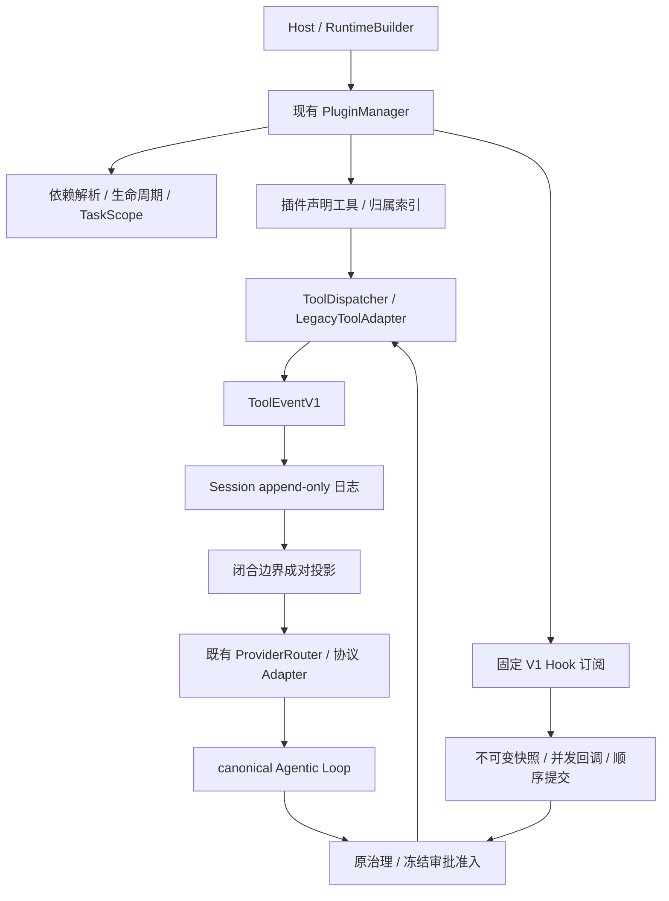

# Registry Kernel Phase 2：真实 Runtime 接线交付账

```text
[Document-Meta]
Document: registry-kernel-phase2-2026-10-27.md
Version: 1.0
Last-Modified: 2026-10-28
Status: 注册模块纵向切片 PRODUCTION WIRED（显式注册）；五段全量通过；远端集成写权限阻塞
Author: Codex
```

## 1. 上轮成果持久化与当前基线

工作分支 `codex/registry-driven-kernel`；KC 远端基线仍为
`82724dc32f927f014e79c4d8aee20d769b87fced`。
开工时 14 个待提交文件与上轮保存的补丁 SHA-256 完全相同：
`807802580841dc848ffd5a60c6a6c6b2e62e79eaf0b590c513537c41b3bbca4e`。
不存在恢复成 KC 原始代码后冒充继续实施的情况。

复核范围、敏感扫描、严格架构与文档检查后，上轮成果已提交为
**`cad81196e7e11c7082d60ef7ea1e360412e58daa`**。
通过 `scripts/commit.ps1` 提交；检出后的 hook 文件没有可执行位，Git 曾提示未自动执行，
随即按相同 author 环境用 Bash 手动运行两个原版 hook，均通过，未跳过或修改判据。

原上轮全量日志仍可复核：352 suites / 8923 passed / 0 failed / 51 ignored。
本轮数字另记，不把历史成功冒充本轮成功。

用户授权新分支→PR，不合并 main。Git 推送目标本来就是
`HEAD:refs/heads/codex/registry-driven-kernel`，并非 main，但返回
`Permission to Apeireth/Apeireth.git denied to Jimmyxiao2009`（403）。
GitHub 连接器确认同一登录；连接器从 KC SHA 创建同名新分支也返回
`Resource not accessible by integration`（403）。这是当前集成写权限问题；更换分支名不能解决。
当前不能声称已远端持久化、已创建代码 PR 或 CI 已验证本批提交。
进一步用同账号 `gh api` 复核：仓库 metadata 的 `permissions.push=true`，账号本身具备 push 权限；
但 `gh` REST 创建新分支及 Git 显式使用 gh credential helper 也均返回写入 403。
所以阻塞是当前集成凭据的仓库写授权，不应要求用户换账号，也不能误判为 main 保护规则。

## 2. 最终结构与注册入口



没有创建第二份 Module Registry。V1 模块是现有 `Plugin`：
`manifest` 声明 id/version/dependencies/capabilities，`tools` 提供实现，
`hooks` 声明固定 `ModuleHookV1`，`on_hook` 返回自有注册工具请求。
已有 `ExtensionCatalog` 及归属索引保留。
`Runtime::plugins()` 是生命周期控制面的读入口；历史 `module_registry()` 仍返回兼容 BehaviorRegistry，
不能将这个旧名称误读为另一个新的生命周期所有者。

### 新模块的最小接线入口

实现现有 `Plugin` 的 `manifest/tools/initialize/shutdown`，并声明 `hooks/on_hook`；
Host 用 `Runtime::builder().with_plugin(module).build().await` 注册并启动，
再调用原 `Runtime::execute(TurnRequest)`。Hook 只能请求该模块已声明工具，
不需要修改 `execute.rs` 增加业务分支。
可直接运行的最小模块、模拟 Provider 与完整回合见
[registry_runtime_v1.rs](../../crates/engine/runtime/tests/registry_runtime_v1.rs)。
`HookToolRequest.execution` 由模块提供稳定内部身份；同一逻辑操作重试时应复用，
不是依靠工具名字或文本猜测幂等性。

### Registry 生命周期 API

- `PluginManager::{register, resolve_order, initialize, start, stop, unregister}`。
- `start_all` 保留已有失败后已启动插件仍 Active 的语义；Runtime 用
  `start_all_or_rollback`，失败后清理部分初始化模块及已启动依赖。
- `state/errors/task_scope/cancel` 提供状态、每模块最近 32 项生命周期错误及取消口。
- `Runtime::{register_module, stop_module, unregister_module, cancel_module}` 是同一 manager 的 facade。
  动态注册限工具/Hook 模块；Provider 成员变更需要重建 Runtime。

Runtime facade 的注册、stop/unregister 需要独占 `&mut Runtime`，由宿主在静止边界操作；
`cancel_module(&self)` 可以与回合并发使用。Registry 可以排水持有 scope 的活跃模块任务，
但本批没有实现多个共享 Arc 宿主在其他回合运行时在线修改 Registry 的热插拔控制面。

```text
Registered → Initializing → Initialized → Starting → Active (= Running)
                                                      ↓
                                                   Stopping → Stopped
失败 → Failed；清理状态独立保留，清理失败不能 Unregister
```

新初始化/启动按拓扑顺序；缺依赖、环、重复 ID/能力/工具名称在执行初始化前拒绝。
停止先拒新任务、取消并排水，再反依赖顺序 shutdown。
尚有运行依赖者时不能停止其依赖；尚有注册依赖者时不能移除依赖。
初始化/启动 panic 记 Failed；shutdown 失败记账并继续清理其他模块，允许再次尝试清理。
不宣称失败回滚了已完成的外部副作用，也没有实现自动重启。

`PluginContext.tasks` 与 Runtime 的 Hook/工具使用同一 `ModuleTaskScope`。
模块自建后台任务必须使用这个 scope；宿主任意脱离 scope 的线程/任务不能被本协议强制回收。
异步取消是协作式取消；同步阻塞代码仍须模块自己遵守截止时间及 shutdown 契约。
缓存的 Provider handle 也受 owner scope 约束，停止后不能继续调用已关闭资源。

## 3. Hook 的真实执行边界

| V1 Point | 实际接线路径 |
|---|---|
| SessionStart | accepted TurnStart 边界；按模块/会话日志保证仅首次调用，非每回合 SessionStart |
| BeforeModelCall | 既有 checked hook 边界；工具结果提交后构造下一请求 |
| AfterModelCall | 收到 candidate、进入业务分支前；快照包含 candidate |
| BeforeToolCall | 既有串行/窗口 admission 的通用 hook 边界 |
| AfterToolCall | 工具已有结果的通用 hook 边界；未闭合调用批内只记事实，延迟消息投影 |
| OnIdle | AfterTurn 已提交边界；结果保存供下一次请求使用 |
| BeforeCompaction | 真实预算触发后的压缩尝试前；没有到期不发 |
| SessionEnd | 宿主显式 `Runtime::end_session`；持有同一 session 锁，拒绝未决调用/审批；幂等关闭 |

回调获得 `HookContextV1` 的不可变 Arc 消息快照、candidate、工具调用/结果及 request/trace/session 身份，
没有 Session 写句柄、Provider 请求写句柄或任意执行入口。
`HookToolRequest` 提供稳定内部执行 ID 和工具参数；Runtime 生成 `module_<execution-id>` wire id，
验证工具归属，不能冒充其他模块或内部 control。事件来源由 Runtime 标记为 module。

回调按固定拓扑计划提交，允许并发完成；最终按计划顺序执行工具和记账，不按竞速结果抢先注入。
默认每 pass 至多 4 个回调、回调总期限 5 秒（含排队）、每模块每 pass 至多 16 个请求。
回调错误、panic、超时和取消隔离为明确状态；不会跳过其他健康模块。
自动工具的错误作为 ToolResult 返回；基础设施/存储错误、硬治理不变量及配额熔断仍会传播。
自动工具若需要人工审批，返回未执行的错误结果，不能建立隐藏审批或绕过人工批准。

V1 AfterToolCall 订阅构成模型工具串行屏障：其自动工作尚未进入旧滚动池的资源分类。
未订阅该点的配置保持原并行窗口。此限制不串行化 Provider 请求或跨会话回合，也没有全局模型锁。
恢复这个配置的工具并行，需要先把自动工作并入同一资源计划，不能单独开一条并行调用后门。

同一会话由原锁串行，跨会话回调允许重入，插件须按 Send/Sync 契约保护自身状态。
自动工具调用不递归触发工具 Hook；不存在动态 Hook 管线或无限重入。
调用方取消时 JoinSet 丢弃其拥有的任务；模块 cancel 同时取消回调和工具，stop 等待 scope 排空。

### 去重、限额与 Provider 合法性

调用执行前按会话日志查内部 TaskId；相同来源/调用的重复请求跳过，同身份不同调用整批拒绝。
批次内冲突在任何工具副作用前检查。不同会话不共享该去重账。
待投影事实最多 64 项、256 KiB；执行前预留可提交错误记录的空间，满额拒绝新副作用。
超大结果明确记录可能已经执行，不建议安全重试。

工具事实和投影标记通过原 Session record/extend 入日志。
模型尚有未回答调用时暂存事实；闭合后追加 assistant call/tool result 对并记录 projected ID，
不会将自动结果插进模型调用批中，也不会修改已在执行的模型请求。
V1 请求边界与四种协议 Adapter 均检查闭合历史。
并行调用的 Anthropic/Gemini 结果合入一个响应 turn；Gemini 调用/结果同时保留 wire ID。
真实云 API 尚未实测；既有 canonical Anthropic 生产 provider 仍是拒绝工具的文本通道，未冒充已升级。

持久事实保存后可避免日志重放的重复执行；进程在外部副作用完成与事实保存之间崩溃，
不能保证外部系统 exactly-once，仍需工具自身的事务/幂等支持。
新代码继续读取旧会话；旧二进制不保证识别新增的 V1 事件。
回滚应停用新模块并保留兼容 reader 和历史消息，不能删除日志；详见 ADR-0019。

## 4. 统一 Dispatcher 与兼容清单

模型路径：Loop → 注册表联合查询 → Schema/Scope → 原治理与冻结审批 →
LegacyToolAdapter → 模块工具 → ToolEventV1/兼容 ToolResult → Loop。
Hook 路径调用相同 admission/dispatch，不建立第二个权限决策器。

`ToolDispatcher` 仅持有 DispatchLimits 和 Session 工具范围，工具目录仍归 PluginManager/CapabilityRegistry。
`LegacyToolAdapter` 转发 invoke、invoke_frozen、invoke_in_session 及冻结准备，保留批准载荷与 Session ID。
参数采用本地 JSON Schema 校验，禁用 schema 的网络/文件解析功能；错误不回显参数值。
V1 模块及声明 strict 的工具使用完整 Schema。旧非 strict ABI 通过 Adapter 显式允许根对象额外字段，
因为旧工具反序列化本来忽略这些字段，但冻结审批必须继续绑定原始参数（包括额外字段和顺序）。
类型、必填项和其他 Schema 约束仍检查；没有按 Shell 名称设置例外，也没有修改 Provider 的工具声明。
默认执行期限 600 秒、参数/结果各 16 MiB，工具自身更严限制继续生效。
所有调用共用相关性、panic/取消/期限和输出预算检查。新增执行错误具有 DispatchFailure code/message；
旧治理/工具错误保持原渲染和 retryability，未强行重写全部旧错误格式。

`ToolScope::{All, Only}` 通过 `runtime.tool_dispatcher().set_scope(session, ...)` 同时约束可见目录与调用，
包括模型伪造未声明工具名及内部 control。它是额外限制，不能授予治理未允许的权限。
该表是本 Runtime 的内存配置，重启后宿主必须重装，不能当作持久授权来源或完整实例系统。

| 兼容面 | 本批状态与未迁移部分 |
|---|---|
| 旧 Plugin | 默认 start 无副作用、无 V1 Hook；继续使用原工具 ABI |
| 旧参数 ABI | 非 strict 工具保留根对象额外字段的兼容语义；V1/strict 工具完整校验，旧权限和冻结绑定不降级 |
| 持久工具事件 | uses_tool_events_v1 显式升级；V1 Hook 自动启用。默认旧插件的持久日志不新增随机执行身份，保留 KC 逐字节不变断言 |
| 宿主 CapabilityProvider / 动态工具 | 目录保留，Runtime 交付的工具均经过 LegacyToolAdapter；宿主拥有的注册项仍由宿主卸载，不冒充已归模块生命周期管理 |
| Shell / Filesystem / Process / Memory 工具 | 既有实现保留，经公共 Adapter 执行；本批未重写、未迁移其所有者生命周期或自动记忆 overlay |
| BehaviorModule / PromptOverlay | 原固定行为钩子与系统 overlay 保留，作为明确旧 ABI；旧 Retry feedback 仍走 user retry scaffolding。新 Plugin Hook 没有 overlay、Retry 或写 User Message 的返回通道 |
| SubLoop | 原预算/工具白名单/治理保留；从 Runtime 获得同一批 Adapter，现转发 Session ID；仍是临时上下文和 ToolResult 列表，未升级独立实例或独立持久 ToolEvent 账 |
| 人工拒绝、截断及取消未执行槽 | 保留原合成 ToolResult、会话/trace 审计；不伪造为已执行模块事实 |
| 内部 control | KC 注册式纯状态命令保留，受工具范围约束；不经外部副作用审批，不授予 Shell 等能力 |
| Provider / 流式 Provider | owner scope 取消与旧路由/健康/热配置转发；成员热插拔需 Runtime rebuild |

主 Loop 残留耦合逐项审计：计划模式的通用投影/配额和冻结审批状态机仍在；
旧 behavior overlay 装配、Retry 的 user scaffolding、重复调用提示及上下文压缩策略仍在；这些不是本批新造的业务分支。
Memory/Profile/organ 的具体实现位于装配/模块，旧 overlay 迁移未完成。
没有 Shell/Filesystem/Android 工具名字面量分派或系统进程执行；准入/执行已抽到 dispatch_admission。

## 5. 文件、依赖与验证

- core：既有 Lifecycle 增加 Initialized/Starting 检查点，保留旧合法跳转兼容。
- plugin：既有 Plugin/Manager/Registry 生命周期扩展；新增 hooks/task_scope；Provider handle scope 适配。
- runtime：dispatcher、registered_hooks、module_host；从 execute 抽出 dispatch_admission，
  从 session 抽出 session_events，公开旧路径保留；SubLoop 传递 Session ID。
- protocol：保留上轮事件模型与四适配器修正，补并行结果 turn 分组和 Gemini ID 回传。
- gateway 测试：两项共享进程环境变量的渠道配置测试加互斥与退出恢复；原断言、测试数和并行门禁不变。
- orchestration 测试：修正输出环并发测试的完成标记读取顺序，终态先观察、再读取以排空；
  不改生产代码、容量、断言或并行数。12 项原测试通过，默认并行测试二进制重复 100 次全通过。
- runtime 外部直接依赖 +1：jsonschema 0.33，default-features=false；Cargo.lock 由 Cargo 更新，
  既有包版本不主动升级。无新增 crate、内部生产依赖边、裸环境变量或 LOCKED 修改。

### 本批实测环境与命令

Rust/Cargo 1.97.1（仓库锁定工具链）、PowerShell 7.6.0，Linux Cloud；Cargo jobs=2，
保留 debug assertions，只关闭调试符号及 incremental 以适应本机资源。
DBus/systemd 开发文件由工作区外临时目录提供；没有降低源码或门禁要求。
本容器 PID 1 不回收孤儿进程，外部 runner 只回收已死亡的子进程，不发送信号、
不修改测试、断言或命令退出码；门禁脚本本身未改。

| 检查 | 实际结果与证据 |
|---|---|
| `cargo test -p apeireth-runtime --test cognitive_module_abi --test registry_runtime_v1 --locked` | 旧 ABI 20 passed；新真实 Runtime 25 passed。完整门禁再次覆盖 |
| `cargo test -p apeireth-protocol --test tool_events_v1 --locked` | 17 passed；含四协议配对与并行结果 turn，完整门禁覆盖 |
| 新 Runtime E2E | 同一真实回合的每个捕获请求都经四种实际协议 Adapter 校验；同时覆盖 module/model 两种事实来源与持久重放 |
| 原 Shell 冻结审批回归 | 6 passed，全部防篡改断言保留；完整门禁覆盖 |
| 渠道环境竞态回归 | 7 passed；默认并行二进制重复 20/20 通过 |
| 输出环并发回归 | 12 passed；默认并行二进制重复 100/100 通过 |
| `cargo check -p apeireth-runtime --lib --target aarch64-linux-android --locked` | 通过（最后顺序修复后复跑）。仅 Rust 核心检查；无 NDK 链接、JNI、App 或硬件实测 |
| `python scripts/arch_guard.py --strict` | violations=0；沿用既有例外，未新增；缩表提示不等于违规 |
| `python scripts/arch_guard.py --self-test` | 4/4；执行边界覆盖扩展后复核 |
| `python scripts/docs_links.py --check` / `docs_index.py --check` | 断链=0、索引问题=0；44 项既有政策保留缺失未增加 |
| staged secret scan / neutral terms | 通过；未纳入凭据、运行日志或无关文件 |
| 五段全量门禁 | 353 suites / 8949 passed / 0 failed / 51 ignored；五段均通过，退出码 0；`logs/gate-full-registry-phase2-final2.log` |

完整门禁命令仍为 `pwsh -NoProfile -File scripts/gate_full.ps1`（只通过 `-Log` 分离日志）。
最终完成于 2026-10-28 00:33:08 UTC：GATE FULL PASSED。主工作区 276 suites / 6640 passed / 0 failed / 18 ignored；图像家族 77 suites / 2309 passed / 0 failed / 33 ignored。两组 Clippy（-D warnings）和全仓格式检查均通过。
日志中的测试数量为本批实测，历史单一真源 [test-baseline.md](../03-reference/test-baseline.md)
不追溯改写。源码提交后再以真实提交 SHA 更新受影响 claims，文档状态最终检查结果随后记账。

### 原始失败与修复记录

1. 初版随机工具事实改变了旧插件事件载荷，KC 两项逐字节对比失败；改为 V1 持久格式显式升级，
   旧调用仍走同一 Adapter，原 KC 四项复跑全通过。
2. 对全部旧自定义 Provider 加强历史检查，破坏 log-only 不变量测试的故意退化调用批；
   校验收在 V1 请求边界和实际协议 Adapter，原四项不变量测试复跑全通过。
3. 两次早期全量编译因待投影错误预算、自动工具并发屏障复核主动终止（143），不能记为通过。
4. `gate-full-registry-phase2-release.log` 主工作区实际 276 suites / 6635 passed / 4 failed / 18 ignored。
   其中 1 项是网关测试共享环境竞态，另 3 项是新 Schema 与旧审批参数 ABI 不兼容。
   修复后渠道 7/7，原并发重复 20 次全通过；Shell 审批 6/6（含全部防篡改断言）通过。
   该失败日志的通用 classifier 标为 oom，但 cgroup oom/oom_kill 均为 0，实际为上述断言失败，不能据此宣称环境 OOM。
5. `gate-full-registry-phase2-verified.log` 曾于 2026-10-27 23:44:49 UTC 完成五段通过，
   实际 353 suites / 8948 passed / 0 failed / 51 ignored。
   收口新增混合 ABI 回归又发现：旧 TurnStart Retry 跳过 V1 SessionStart，但仍继续模型回合。
   先实际复现失败，再修正 accepted-start 的生命周期分支；新增回归及原 cognitive_module_abi 通过。
   本轮最终版本另跑完整门禁，不能拿这次较早成功冒充新增回归后的全量结果。
6. `gate-full-registry-phase2-delivery.log` 完成主工作区 276 suites / 6640 passed / 0 failed / 18 ignored，
   Clippy 与 fmt 通过后，进程在图像测试期间消失，日志于 2026-10-28 00:07:37 UTC 截断，
   无退出码或完成标记；没有 OOM 记录，也无新增失败，终止原因未确认，不能记作全量通过。
   再次用同一未改动门禁执行，外部 runner 独立保存退出码，日志为 `gate-full-registry-phase2-final.log`。
7. 该重跑于 2026-10-28 00:12:45 UTC 因原 `job_output_ring` 并发测试失败，
   实际 276 suites / 6639 passed / 1 failed / 18 ignored。测试先读取空 slice，
   然后观察到生产者新置的 done，提前终止而漏读已有数据；对应生产模块与测试此前均未修改。
   完成标记改为读取 slice 前观察，保留全部完整字节、游标及 lossless 断言；
   测试 12/12、默认并行二进制重复 100 次全通过。门禁 classifier 同样误报 oom，计数仍为 0。
   最终完整重跑单独使用 `gate-full-registry-phase2-final2.log`，不覆盖任何失败证据。

所有原断言和测试均保留；没有全局单线程、批量 ignored、删除测试或压低门禁。

## 6. 本轮未完成与下一阶段

没有实施完整 Android/Kotlin/JNI、Memory/Profile 业务迁移、完整 Multi-Instance 或组网裁剪。
新注册插件的纵向切片属于 PRODUCTION WIRED（宿主显式注册），没有新增默认业务模块，
不能写 DEFAULT ENABLED 或 HARDWARE VALIDATED。
下一步优先迁移一组既有工具 owner 到 Plugin 生命周期，再迁移 Memory 自动 recall，
随后将自动工具资源计划纳入旧滚动池，完善持久实例授权、独立取消与统计。
需要共享 Runtime 在线热插拔的宿主，还须增加受控的生命周期命令入口，保持上述取消/排水语义。
不更改 Memory DB 或删除桌面功能来掩盖未完成项。
